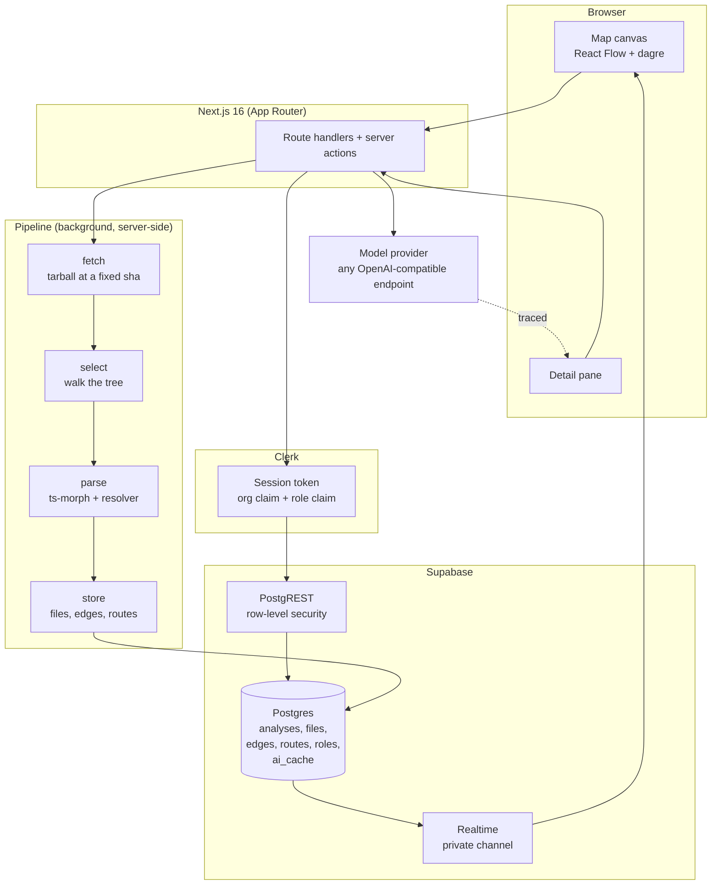

<div align="center">

# Anatomy

**Turn any public TypeScript or JavaScript repository into an interactive dependency map.**

Paste a repository URL. Anatomy parses the source for real, folds it into
folders, draws the imports as edges, and answers questions about the structure —
without ever guessing that two files are connected.

</div>

---

## The problem

Codebases routinely contain code nobody on the team has read. An agent wrote it,
someone confirmed it worked, it shipped. It works — and it accumulates structure
nobody chose. Files that import through three layers of re-exports. A utility
forty files depend on. A module nothing has referenced in months.

The questions that follow are structural. *What is this file? What depends on
it? What breaks if I change it?* Answering them today means reading imports one
file at a time and holding the results in your head, which stops working around
thirty files and stops being attempted at all somewhere past a hundred.

## The rule everything rests on

> **Every box and every line on the canvas comes from really parsing the code.**

The AI may explain and label. It may never decide that two files are connected,
and it may never walk the graph when arithmetic can do it instead.

A dependency graph that is ninety percent right is worse than no graph, because
there is no way to tell which ten percent is wrong. The moment a model is
allowed to guess at an edge, every edge becomes a *maybe*, and the product
becomes a nice-looking picture.

## Who it is for

A developer opening a codebase they didn't write — most often one they built
themselves with an agent, across many sessions, and can no longer hold in their
head. They can read code fine. What they can't see is its shape.

Teams that ship this way inherit the same structure in every repository they
touch. An analysis belongs to an organization rather than to whoever happened
to run it.

## What it does

| | |
|---|---|
| **Real AST parsing** | `ts-morph` reads source files and turns imports, re-exports, dynamic `import()` and `require()` calls into edges. Nothing is inferred from naming conventions alone. |
| **Honest coverage** | Every skipped file is reported with a reason and a count. A file that couldn't be parsed is never quietly dropped. |
| **Interactive canvas** | Folders fold into boxes, boxes expand into files, and the layout is computed with dagre. Select anything to see its real neighbours. |
| **Blast radius** | Pure arithmetic over the edge list: what breaks two levels out if this file changes. |
| **Route table** | Recovered from syntax only, and withheld with a stated reason when it cannot be recovered exactly. |
| **Grounded explanations** | A file is explained from its actual imports and importers. Every path mentioned in the prose becomes a link that moves the map. |
| **Live progress** | Parsing a real repository is not instant, so the pipeline reports stages as it goes, over a private realtime channel. |
| **Multi-tenant by policy** | Rows belong to an organization and row-level security reads the organization off the Clerk token. Signing in from another organization means the first one's rows are absent from the query, not filtered out by the interface. |
| **Traced and cached AI** | Every model call is traced, and the cache read happens *inside* the traced call — so a cache hit appears as a recorded run containing no model call. |

See [docs/features.md](docs/features.md) for the full catalogue, including what
is **not** implemented.

## Workflow

1. **Sign in** with GitHub, Google or email.
2. **Paste a repository URL** — `github.com/owner/name` is enough.
3. **Watch it map.** The pipeline fetches the archive at a fixed commit, walks
   it, parses the imports, and stores the result. Progress appears as it goes.
4. **Read the shape.** Folders are boxes; open one and it becomes its files.
   Click a file to see what it imports, what imports it, and what breaks two
   levels out.
5. **Ask for an explanation.** The model is handed that file's source and its
   real neighbours — and nothing else.

## Architecture



The parser runs standalone and imports nothing from Next.js, React or the
database client. Path in, data out. That is what lets `pnpm parse` work from a
plain terminal, and it is why adding a framework never touches parsing code.

Full detail in [docs/architecture.md](docs/architecture.md).

## Technology stack

| Layer | Choice |
|---|---|
| Framework | Next.js 16.3.6 (App Router, Turbopack), React 19.2.8, TypeScript 5.9.3 (strict) |
| Parsing | ts-morph 28 over the TypeScript compiler API |
| Canvas | @xyflow/react 12.12 with dagre 3.1 for layout |
| Identity | Clerk 7.9 — sign-in, organizations, JWT session tokens |
| Database | Supabase (Postgres + PostgREST + Realtime) with RLS on every table |
| AI | OpenAI SDK 7.23 against any OpenAI-compatible endpoint, traced with LangSmith 0.10 |
| Archive | tar 7.5, streamed from `codeload.github.com` |
| Styling | Tailwind CSS 4.3 |
| Tooling | pnpm 10, ESLint 9 |

## Requirements

- **Node.js 22.18 or newer** (developed and tested on 24.21.0). The `scripts/`
  entry points run TypeScript directly, which needs Node's native type
  stripping.
- **pnpm 10** — the version is pinned in `package.json` via `packageManager`.
- A **Clerk application**, a **Supabase project**, and a **model provider
  key**. The model provider is optional for everything except the Explain
  button.

## Getting started

```bash
git clone https://github.com/ravirraj/anatomy.git
cd anatomy
pnpm install
cp .env.example .env.local     # then fill it in
```

### Environment

```bash
# CLERK
NEXT_PUBLIC_CLERK_SIGN_IN_URL=/sign-in
NEXT_PUBLIC_CLERK_SIGN_UP_URL=/sign-up
NEXT_PUBLIC_CLERK_SIGN_IN_FALLBACK_REDIRECT_URL=/
NEXT_PUBLIC_CLERK_SIGN_UP_FALLBACK_REDIRECT_URL=/
NEXT_PUBLIC_CLERK_PUBLISHABLE_KEY=
CLERK_SECRET_KEY=

# SUPABASE
NEXT_PUBLIC_SUPABASE_URL=
NEXT_PUBLIC_SUPABASE_PUBLISHABLE_KEY=
SUPABASE_SECRET_KEY=

# LANGSMITH (optional - tracing is off without it, and says so)
LANGSMITH_TRACING=true
LANGSMITH_API_KEY=
LANGSMITH_PROJECT=anatomy
LANGSMITH_ENDPOINT=https://api.smith.langchain.com

# Model provider - OpenAI by default, or any OpenAI-compatible endpoint
OPENAI_API_KEY=
# AI_BASE_URL=https://generativelanguage.googleapis.com/v1beta/openai/
# AI_API_KEY=
# AI_MODEL_EXPLAIN=
# AI_MODEL_CLASSIFY=
```

See [`.env.example`](.env.example) for the authoritative list, and
[docs/development.md](docs/development.md) for how to obtain each value.

Two Clerk-side steps are easy to miss and both break the app visibly:

- **Enable Organizations.** Without it the API returns
  `organization_not_enabled` and the app cannot create the team a first
  sign-in needs.
- **Add `{"org_name": "{{org.name}}"}` to the session token.** The dashboard
  reads that claim and throws `Session token has no org_name claim` without it.

### Database

Apply the migrations in `supabase/migrations/` in filename order. They create
every table, enable row-level security on all of them, and create the policies
that read the organization claim off the Clerk token.

```bash
pnpm dlx supabase login
pnpm dlx supabase link --project-ref <your-project-ref>
pnpm dlx supabase db push
```

`supabase db push` applies each migration as a unit and records it, so it is
re-runnable and will not double-apply. To apply them by hand instead, paste
them into the Supabase SQL editor in the same order.

### Run it

```bash
pnpm dev
```

Open <http://localhost:3000>, sign in, and paste a repository URL.

## Commands

| Command | What it does |
|---|---|
| `pnpm dev` | The development server. |
| `pnpm build` | Production build. |
| `pnpm lint` | ESLint over the project. |
| `pnpm test` | The two test suites (see below). |
| `pnpm check-links` | Checks every relative link and anchor in the documentation. |
| `pnpm parse <dir>` | Parse a directory and print what was found. No API keys needed. |
| `pnpm map-counts` | How many nodes the map would draw, for a stored result. |
| `pnpm insights` | Cycles and other structural findings. |
| `pnpm analyze <url> --org <id>` | Run the pipeline from a plain script. |

`pnpm parse` is the clearest statement of what the project is: the parser takes
a path and returns files, edges and a coverage report, with nothing else
running.

```
$ pnpm parse .
Projects  . (Next.js)
Files     found 86  parsed 84  skipped 2
Folders   19 distinct modules
Edges     191 after removing duplicates (55 type-only)
```

## Testing

There is no test framework. The suites are plain scripts that assert on real
behaviour and exit non-zero on failure, so they run in CI as they run locally.

| Suite | Covers |
|---|---|
| `scripts/test-provider.ts` | The AI layer against a fake OpenAI-compatible endpoint: request shape, provider-specific parameters, the cache read inside the traced call, the model in the cache key, and the JSON-schema fallback. |
| `scripts/test-explanation-store.ts` | The explanation store: answers survive a re-render, a request in flight is not stored as an answer, and a store that cannot be written still works in memory. |

```bash
pnpm test
pnpm check-links
```

The link checker walks every markdown file and resolves every relative link
and anchor, so a moved file or a renamed heading fails rather than quietly
breaking a page.

The parser and the graph engine are pure functions and are exercised through
`pnpm parse` against real repositories rather than through unit tests.

## Supported languages and frameworks

**Languages: TypeScript and JavaScript only.** The parser is built on ts-morph,
the TypeScript compiler API. A repository written in Python, Go, Java or Rust
contributes zero files — those files are not "skipped", they are never
considered. This is a deliberate boundary, not an oversight: getting one
language genuinely right is the whole proposition. See
[docs/features.md](docs/features.md#not-currently-supported) and
[TODO.md](TODO.md#4-multi-language-and-framework-support).

**Frameworks recognised**, by dependency in the project's `package.json`:

| Framework | Detected by | Routes recovered |
|---|---|---|
| Next.js | `next` | App Router route handlers (`app/**/route.ts`) |
| NestJS | `@nestjs/core` | Controller and method decorators |
| Express | `express` | Never — see below |
| Docusaurus | `@docusaurus/core` | None (a static host answers the path) |
| React | `react` | None |
| *fallback* | always | None |

Express routes are **always withheld**, with the reason stated: Express
composes each route at runtime from the routers and paths it is mounted on, so
there is no single place in the source that says what the URL is. Similarly,
Next.js routes are withheld when `next.config` sets a computed `basePath` or
`pageExtensions`. The route table shows nothing rather than something wrong.

Two cases are omitted rather than withheld, because there is a route but no
method to state: a Next.js **Pages Router** page has no method written
anywhere, and a `pages/api/**` handler picks its method at runtime. The route
table lists App Router route handlers and NestJS controller methods.

## Security and privacy

- **Identity** is Clerk's. The application never asks the identity provider a
  question at runtime; it reads claims off the session token.
- **Authorization** is a Postgres policy, not application code. If a query needs
  a `where` clause to return the right rows, the policy is wrong.
- **Row-level security is on for every table**, enforced by a database event
  trigger, so a table created in `public` cannot silently be left unprotected.
- **Only public repositories are analysed**, and no GitHub token is stored or
  used — the pipeline is entirely unauthenticated.
- **Source code is sent to the model provider** when you ask for an explanation.
  That is the one place repository content leaves the system, and it is opt-in
  per click.
- **Answers are cached** in the `ai_cache` table, scoped to the organization.
  Traces go to LangSmith only if you configure a key.

Read [docs/security.md](docs/security.md) for the full picture, the known
limitations, and a verification checklist.

## Current status

Anatomy is a working application, not a prototype: the pipeline runs, the map
draws, the policies isolate tenants, and the explanations are cached and
traced. It is **not** finished in the following ways, all of which are tracked
in [TODO.md](TODO.md):

- **No repository-wide question answering.** Explanations are per file or per
  folder, not across the repository. This is the largest missing feature.
- **No symbol-level search.** You can find a file through the map; you cannot
  search for a function or a class.
- **TypeScript and JavaScript only.**
- **No call graph.** Only import and re-export edges are recovered.
- **No public deployment.** There is no hosted instance and no recorded
  demonstration video yet.
- **Unlicensed.** A `LICENSE` file is to be added.

## Documentation

| Document | What is in it |
|---|---|
| [docs/README.md](docs/README.md) | Index of everything below. |
| [docs/architecture.md](docs/architecture.md) | Components, data flow, the parser, the graph engine, the AI lifecycle, deployment. |
| [docs/features.md](docs/features.md) | Feature catalogue: what works, what is partial, what is planned. |
| [docs/development.md](docs/development.md) | Reproducible setup, commands, troubleshooting, how to extend each subsystem. |
| [docs/ai-system.md](docs/ai-system.md) | The AI implementation today, and a proposed design for repository-wide Q&A. |
| [docs/security.md](docs/security.md) | Trust boundaries, data flow, known limitations, checklist. |
| [docs/ROADMAP.md](docs/ROADMAP.md) | Public-facing roadmap. |
| [docs/project-doc.md](docs/project-doc.md) | The product decisions behind the build, with the reasoning. |
| [docs/specs/](docs/specs/) | One specification per phase, written before the phase. |
| [TODO.md](TODO.md) | The authoritative task list. |
| [CONTRIBUTING.md](CONTRIBUTING.md) | How to contribute. |
| [CHANGELOG.md](CHANGELOG.md) | Release history. |

## Contributing

See [CONTRIBUTING.md](CONTRIBUTING.md). The project is written spec-first: a
phase gets a specification in `docs/specs/` before it is built.

## License

To be added. Until then the repository is not licensed for reuse.
