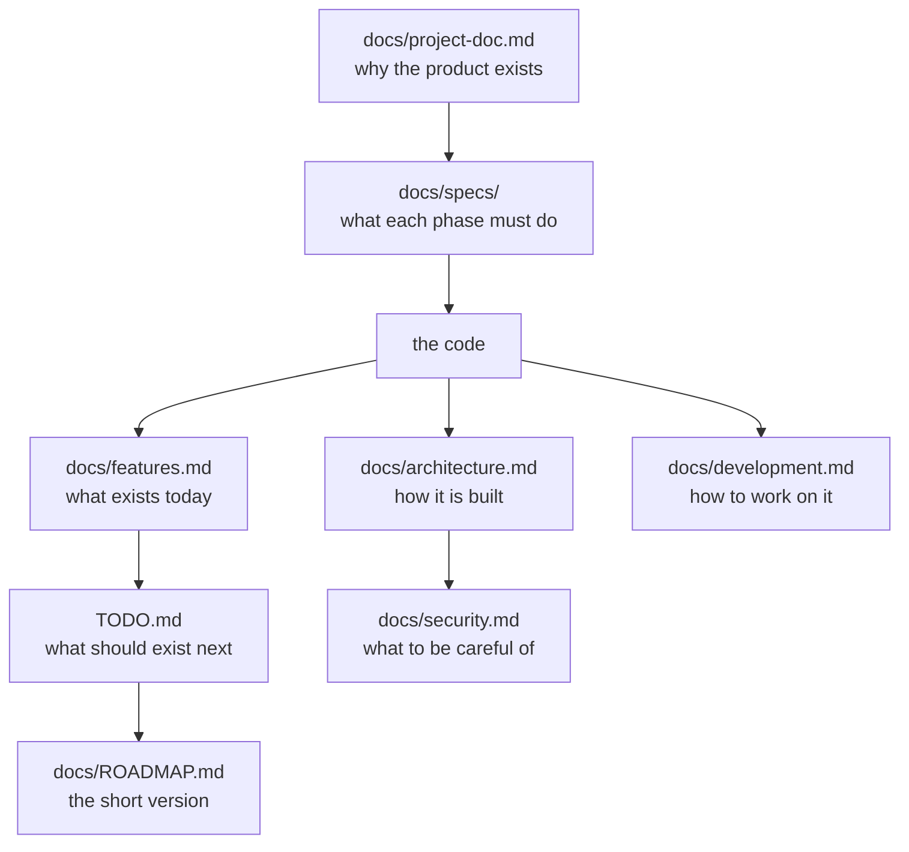

# Documentation

Everything written about Anatomy. Start at the top.

| Document | What is in it | Read it when |
|---|---|---|
| [../README.md](../README.md) | The project overview: the problem, what it does, how to run it, what it does not do | You have just arrived |
| [architecture.md](architecture.md) | Components, data flow, the parser, the graph engine, the AI lifecycle, tenancy, deployment trade-offs | You want to understand how it works |
| [features.md](features.md) | The feature catalogue: implemented, needs validation, partial, planned, not supported | You want to know whether a feature exists |
| [development.md](development.md) | Reproducible setup, every command, troubleshooting, how to extend each subsystem | You are setting up or hacking on it |
| [ai-system.md](ai-system.md) | The AI implementation today, and the design for repository-wide Q&A | You are working on the AI layer |
| [security.md](security.md) | Trust boundaries, what is stored, where data goes, known limitations, a verification checklist | You are deploying it or reviewing it |
| [ROADMAP.md](ROADMAP.md) | The public-facing roadmap | You want to know where it is going |
| [project-doc.md](project-doc.md) | The product decisions behind the build, with the reasoning attached | You want to know *why* it is like this |
| [specs/](specs/) | One specification per phase, written before the phase was built | You want the original intent of a part of the system |
| [../TODO.md](../TODO.md) | The authoritative task list | You are looking for something to do |
| [../CONTRIBUTING.md](../CONTRIBUTING.md) | How to contribute | You are about to open a pull request |
| [../CHANGELOG.md](../CHANGELOG.md) | Release history | You want to know what changed when |

---

## How the documents relate

**The rule is one-directional.** `docs/project-doc.md` and the specs say what
was intended. The code says what exists. `docs/features.md` describes the
code, and `TODO.md` describes what should come next. The two are deliberately
never mixed: a feature that is planned is never described in the present
tense, and a feature that is implemented is never described in the future
tense.

---

## Conventions used here

- **Relative links.** Every link works from the GitHub page, and from a local
  checkout.
- **Diagrams are Mermaid**, so they render in GitHub and in any Mermaid-aware
  editor.
- **Claims are checkable.** A statement about the code names the file that
  implements it, and a statement about behaviour says how it was checked.
- **"Planned" and "implemented" are different words**, and they are not used
  interchangeably.
- **No fabricated content.** No screenshots that do not exist, no benchmark
  numbers that were not measured, no release dates that were not real.
- **Absolute paths are avoided.** "In `lib/graph/`", not "in
  `/home/user/...`".

---

## Keeping the documentation true

Documentation drifts, and a document that is confidently wrong is worse than
no document. Three things guard against it.

**1. The check list.** Every pull request that changes behaviour should
update the documents that describe it. The list is in
[../CONTRIBUTING.md](../CONTRIBUTING.md).

**2. The checkable claims.** Where this documentation quotes a constant, a
type name or a literal string, it is quoted exactly, so a test can compare it
against the code. That is the mechanism that turns "the documentation says"
into "the documentation is wrong, and here is the diff".

**3. The feature catalogue's categories.**
[features.md](features.md) separates what is implemented from what is partial
from what is planned. A change that moves a feature between categories is a
documentation change, not a code change.

---

## A note on the phase specifications

`docs/specs/` holds one specification per phase, written **before** the phase
was built. They describe behaviour and give an acceptance check; they
deliberately do not name files, because a specification that names files
becomes wrong the moment the implementation moves.

They are kept because they are the clearest statement of intent in the
repository, and because a specification that is now partly wrong is evidence
of what has drifted.

| Spec | Phase |
|---|---|
| [phase-01](specs/phase-01.md) | Auth and teams |
| [phase-02](specs/phase-02.md) | Dashboard and schema |
| [phase-03](specs/phase-03.md) | The parser |
| [phase-04](specs/phase-04.md) | The canvas |
| [phase-05](specs/phase-05.md) | Detail pane |
| [phase-06](specs/phase-06.md) | Graph maths, the rail, and insights |
| [phase-07](specs/phase-07.md) | The pipeline |
| [phase-08](specs/phase-08.md) | Framework adapters |
| [phase-09](specs/phase-09.md) | CommonJS and Express |
| [phase-10](specs/phase-10.md) | Explain, cached and traced |

There is no specification for a phase that has not been specified, and a
specification for a phase that has not been built is in the future tense
throughout.
