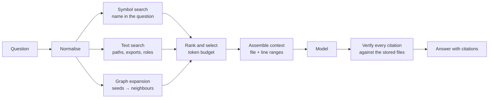

# The AI and retrieval system

What the AI layer does today, how it is built, and a design for the piece that
is not built yet.

The sections are ordered so that the boundary is unmistakable: **sections 1–7
describe code that exists in this repository; section 8 describes a design, and
nothing in it is implemented.**

---

## 1. What exists

| | |
|---|---|
| **Model provider** | Any OpenAI-compatible endpoint. OpenAI by default; Google AI Studio's compatibility layer for Gemini and OpenRouter are both supported through configuration. |
| **Tasks** | Three: `explain-file`, `explain-folder`, `classify-file`. |
| **Context source** | The stored analysis. Every path the model sees was read from the database, never from the request. |
| **Cache** | The `ai_cache` table, scoped to the organization. The read is inside the traced call. |
| **Tracing** | LangSmith, optional. The pane reports whether tracing is on, and why not if it is not. |
| **Repository-wide Q&A** | **Not built.** See section 8. |

---

## 2. One client

`lib/ai/client.ts` is the only module in the repository that imports `openai`.

```ts
client = wrapOpenAI(new OpenAI({ apiKey, baseURL: BASE_URL }), {
  tracingEnabled: tracingStatus().on,
});
```

A client built anywhere else would work and silently go untraced. That is the
whole reason the file exists, and the reason nothing else may construct one.

`wrapOpenAI` comes from `langsmith/wrappers/openai`. It is the integration
point: the OpenAI SDK's calls are recorded as LangSmith runs without the
application knowing LangSmith exists.

### 2.1 The provider is configuration, not code

```env
AI_BASE_URL=          # unset means OpenAI's own API
AI_API_KEY=           # falls back to OPENAI_API_KEY
AI_MODEL_EXPLAIN=     # falls back to OpenAI's pinned explain model
AI_MODEL_CLASSIFY=    # falls back to OpenAI's pinned classify model
```

Two details make this work across providers, and both are tested in
`scripts/test-provider.ts`:

**`verbosity` is OpenAI-only.** It is sent to OpenAI and to nothing else.
Google's compatibility layer ignores unknown fields; other endpoints refuse the
request, and a refusal is a failed explanation.

**`reasoning_effort: "low"` is sent to every provider.** Google maps it onto
Gemini's thinking level. OpenRouter passes it through. It is the one parameter
worth having everywhere, because it is what keeps a reasoning model from
thinking at length about a file it should be able to describe in two
paragraphs.

**Strict JSON schemas are not universal.** The classification task asks for a
strict JSON schema, and falls back to plain JSON mode if the endpoint refuses:

```ts
try {
  // response_format: { type: "json_schema", json_schema: { ... } }
} catch (error) {
  if (!schemaRefused(error)) throw error;
  // response_format: { type: "json_object" }
}
```

`schemaRefused` only recognises a 400, 404 or 422 whose message mentions the
schema. Any other failure is a real failure and is not retried. The answer is
validated either way, so the fallback cannot produce a wrong answer — only a
less constrained one.

---

## 3. Models, and why they are pinned

```ts
export const MODELS = {
  explain: process.env.AI_MODEL_EXPLAIN?.trim() || "gpt-5.5-2026-04-23",
  classify: process.env.AI_MODEL_CLASSIFY?.trim() || "gpt-5.4-mini-2026-03-17",
} as const;
```

The comment in the source says it: *"Exact snapshots, never a moving alias: an
alias changes the model under a cached answer without changing its key."*

If `explain` were an alias like `gpt-5.5`, then one day the alias would point
at a different model, and every answer cached under the old model would be
served for a question now being asked of the new one. The cache key would not
have changed, so nothing would notice.

**The model name is part of every cache key.** Changing it invalidates only
the answers that model wrote, and leaves the others alone.

---

## 4. The cache, and where the read happens

The cache key is:

```ts
createHash("sha256")
  .update(JSON.stringify({ task, version: PROMPT_VERSION, model, input }))
  .digest("hex");
```

`PROMPT_VERSION` is `1`, and it is part of the key. When a prompt's wording
changes, the version is bumped, and old answers stop matching rather than
being served for a question no longer being asked.

### 4.1 The read is inside the traced call

This is the single most important detail in the AI layer:

```ts
const run = traceable(async (question: FileInput): Promise<Explanation> => {
  const key = cacheKey("explain-file", model, question);
  const hit = await deps.cache.read(key);          // <-- first thing inside
  if (hit !== null) return { body: hit, model, cached: true };
  const body = await complete(model, EXPLAIN_FILE_SYSTEM, explainFileMessage(...));
  await deps.cache.write({ key, task: "explain-file", model, body });
  return { body, model, cached: false };
}, traceConfig("explain-file"));
```

The cache read happens **inside** the traced function, not before it. That
means a cache hit appears in the tracing dashboard as a recorded run containing
no model call under it — and a broken cache appears as a trace full of calls.
A cache nobody can verify is just a cache.

### 4.2 The cache is scoped by organization

`ai_cache` has `organization_id`, and its policy reads the organization off
the token, exactly like every other table. The key is a hash, so it is the
same key in every organization — but the rows are separate, and one
organization's answer is not readable by another.

The write goes through the admin client, because a member has no write grant.
The organization id it writes is the one the policy just let the member read.

### 4.3 The cache is never evicted

There is no eviction and no TTL. The table grows with every distinct
question. Tracked in [TODO.md](../TODO.md#7-ai-improvements).

---

## 5. Tracing

```ts
export function traceConfig(name: string) {
  return { name, run_type: "chain", tracingEnabled: tracingStatus().on } as const;
}
```

`tracingStatus()` returns one of:

| State | Meaning |
|---|---|
| `{ on: true, project }` | Tracing is on. |
| `{ on: false, reason }` | Tracing is off, and why. |

The reason is one of: `LANGSMITH_TRACING isn't "true"`, or
`LANGSMITH_API_KEY isn't set`.

**This state is returned with every answer and shown in the pane.** An absent
key otherwise looks exactly like a working setup with no traffic, and there is
no way to tell them apart.

When tracing is off, the function runs exactly the same, untraced.

---

## 6. How the context is built

`lib/analysis/context.ts`. The rule is that **the context comes from the
stored analysis and nowhere else.**

### 6.1 A file

`loadFileInput(db, analysisId, path)` reads:

- the file's row: path, hash, exports, `reached_by`, and its role
- every edge touching it, with both ends' paths, exports and roles

and produces two things: the `FileInput` for the explanation, and a
`ClassifyInput` for the labelling step.

Each neighbour is described by its path, its role, its export names, the kinds
of edge between them, and whether those edges are type-only.

### 6.2 A folder

`loadFolderInput(db, analysisId, dir)` re-folds the stored file list with
**the same folding the map draws** — `foldDirectories` — so the question is
about the box that was clicked and not about some other grouping.

The folder's question is: what is in here, what do these files have in
common, and which imports cross the boundary in or out.

### 6.3 Roles are convention's, not the model's

A neighbour's role is only included when **convention** gave it:

```ts
function conventionRole(rows: RoleRow[]): string | null {
  const row = rows[0];
  return row?.source === "convention" ? row.role : null;
}
```

The reasoning is in the source: a label the model gave one file later would
otherwise change every neighbour's and folder's question, and throw away their
cached answers for nothing the parser found.

### 6.4 A file's own source

The source is fetched from GitHub at the **analysed commit**, and its hash is
compared with the hash the parser stored. If they differ, the explanation
describes code that is not on the map, and the request fails rather than
proceeding.

The source is fetched at most once per request, and only on a cache miss.

---

## 7. The prompts, and the renderer

### 7.1 Three kinds of formatting, and no more

The pane is narrow, and headings cut a few short paragraphs into labelled
fragments. The prompt permits exactly:

- inline code in backticks
- bullet lists
- bold with `**double asterisks**`

and forbids headings, numbered lists, tables, links, italics and code blocks.

**Forbidding formatting outright does not hold** — models do not reliably obey
that, and the result is backticks rendered as backticks: markdown with the
renderer missing. Permitting a small subset and rendering it is the option
that survives contact.

### 7.2 The renderer reduces what it was not given

`components/explanation-text.tsx` renders exactly the three permitted forms,
and reduces anything else rather than printing it as markup:

| The model writes | The pane shows |
|---|---|
| A heading (`## Something`) | A bold line |
| A numbered item (`1. Something`) | A bullet |
| Italics (`_word_`) | Plain words |
| A stray backtick or asterisk | Dropped |
| A fenced code block | Skipped |

Every repository path in the prose — quoted or bare — becomes a link that
moves the map to it.

### 7.3 The honesty instruction

Every prompt carries the same constraint:

> *The lists of imports and importers were resolved by a parser and are
> complete: they are the only connections that exist. Never mention a file
> that isn't named in the input, and never suggest a connection the input
> doesn't list. Write every repository path in full, exactly as given, inside
> backticks. Describe what the code does; don't grade it, rate it, or suggest
> improvements.*

Two things are being prevented at once. The first is an invented path. The
second is a review: *"don't grade it, rate it, or suggest improvements"* is the
product decision that this explains a codebase rather than reviewing one.

### 7.4 The classification task

A file that no convention identified can be labelled by the model. The
permitted roles are a fixed list of seven:

```
service, repository, model, util, config, component, hook
```

**None of them is a routable role.** The roles that decide what is a page, an
endpoint, a router or a controller belong to convention alone, because they
decide the route table and which files read as entry points. A model that
answered `page-route` would be refused, and the file would stay unclassified.

The answer is **checked, not trusted**. `parseRole` throws on a role outside
the list, and a refused answer is never written to the cache.

### 7.5 The context budget

| Constant | Value | What it bounds |
|---|---|---|
| `MAX_SOURCE_CHARS` | 120,000 | The source handed to the model. The largest file the parser reads is well under this; it is a backstop, and the model is told when the cap applied. |
| `EXCERPT_LINES` | 60 | The source handed to the classifier, which needs a sample, not the file. |

---

## 8. What is not built

**There is no repository-wide question answering.** No chat panel, no agent
service, no question interface, and no retrieval over the whole repository. The
`AGENT_URL` variable an earlier revision of the environment template mentioned
is gone, because nothing reads it.

What exists answers exactly two questions, both about a thing you have
already selected:

- *What does this file do?*
- *What is in this folder, and why does so much point at it?*

Both are answered from the selected thing's immediate neighbours. A question
like *"how does authentication work in this repository"* spans files that have
no single common neighbour, and there is no mechanism to find them.

**No symbol search.** The parser extracts the *names* a file exports, and the
detail pane shows them, but there is no index of where a given symbol is
defined, and no way to search for one.

**No evaluation of answer quality.** The cache records that an answer was
produced, not that it was any good.

---

## 9. Proposed: repository-wide question answering

**This is a design, not an implementation.** Nothing in this section exists.

### 9.1 The question it answers

> *How does authentication work in this repository?*
> *Which files does the upload path touch?*
> *What happens between the API route and the database?*

These are cross-file questions, and they are the questions the map cannot
answer. The map answers "what is connected to this"; the missing thing is
"what is the story across these".

### 9.2 The four parts

A correct answer needs four things that the repository does not yet have.

**1. Symbol search.** The parser already extracts export names per file. What
is missing is the other direction — the *definitions* of functions, classes
and constants — and an index from symbol to file. Without it, a question
about a function name cannot be grounded.

**2. Source retrieval.** A ranking of files by relevance to a question. The
text that exists today is the file's path, its role, its export names and its
neighbours — which is enough to find a file by *name*, and not enough to find
it by *meaning*.

**3. Graph traversal.** The dependency graph answers "what is connected to
this", and a cross-file question needs a walk, not a neighbourhood. The
traversal must be done by the application, not the model: the product rule is
that the model may not walk the graph, because a model that walks invents
edges.

**4. Citations.** An answer that says *here is how it works* without saying
*here is the code* is an answer nobody can check. Every claim needs a file
and a line range, and every citation needs to be openable in the map.

### 9.3 A shape for it



**Retrieval is deterministic and happens before the model.** The model is
handed a context that has already been selected, and it is asked to explain
it. It is never asked to find anything, for the same reason it is never asked
to decide that two files are connected.

**Citations are verified after the model answers, not trusted.** A citation is a
path and a line range; the verifier checks the path exists in the stored
analysis and the range is inside it. A citation that fails verification is
removed from the answer, not shown with a warning — an answer with a wrong
citation is the failure mode the whole product exists to avoid.

**When the evidence is insufficient, the answer says so.** The retrieval
returns a confidence, and below a threshold the system answers *"the stored
analysis does not show how this works"* with what it does know. A refusal is a
correct answer when the repository does not contain the answer.

### 9.4 What it needs from the rest of the system

| Dependency | Why | State |
|---|---|---|
| Symbol extraction | To ground a question about a name | Not built. |
| A symbol index | To find a file from a name | Not built. |
| Text retrieval over stored files | To find a file by meaning | Not built. |
| Configurable traversal depth and breadth | To expand seeds without flooding the budget | The traversal exists (`lib/graph/reach.ts`), with a fixed depth of 2. |
| A citation format in the renderer | To show file and line ranges | The renderer links paths; it does not yet show line ranges. |
| An evaluation set | To measure retrieval and citation accuracy | Not built. |

### 9.5 What it must not become

- **Not an agent that walks the graph.** The traversal is the application's
  job. A model that walks invents edges.
- **Not a reviewer.** The product explains a codebase. It does not grade it.
- **Not a writer.** No autonomous modification of code, and no multi-agent
  orchestration. Neither has a demonstrated need here, and both would put a
  model in a position to decide structure — which is the one thing the model
  is never allowed to do.
- **Not a chat that answers from its training data.** If the answer is not in
  the stored analysis, the answer is "the analysis does not show this".

---

## 10. Cost, failure modes, and current limits

### 10.1 Cost

| Driver | Effect |
|---|---|
| The model | Free tiers are slow and rate-limited. A reasoning model asked for two paragraphs will spend tokens thinking. `reasoning_effort: "low"` bounds this. |
| The source | Up to 120,000 characters per explanation. The file's neighbours are listed in full. |
| The cache | A repeated question is free, and the cache is the only thing making a repeat cheap. |
| Labelling | One extra call per file that convention did not identify, before the explanation. It happens once per file, ever, because the role is stored. |

### 10.2 Failure modes

| Failure | What happens |
|---|---|
| The provider is unavailable | The action returns the provider's message. The pane shows it. Nothing is cached. |
| The provider refuses the request shape | The JSON-schema fallback, if it is that kind of refusal. Otherwise the error is surfaced. |
| The model answers with a role it was not allowed to give | Refused. The file stays unclassified. The answer is not cached. |
| The model names a file it was not given | Nothing catches this today. The prompt forbids it; the renderer links a path only if it is a real file, so an invented path renders as plain text rather than a broken link. Detecting it is the **invented-path check**, and it is planned, not built. |
| The model returns an empty answer | An error naming the model and the finish reason. |
| The source has changed since the analysed commit | The explanation fails rather than describing code that is not on the map. |

### 10.3 The gap that matters most

**There is no check that an answer does not name a file that does not
exist.** The prompt forbids it and the renderer degrades gracefully, but
nothing verifies it. This is the check the product's own success criteria
name, and it is the first thing that should be built for the AI layer.

Tracked in [TODO.md](../TODO.md#3-high-priority-features).
