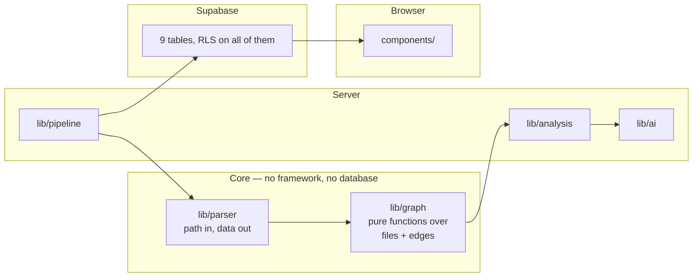

# Architecture

How Anatomy is put together, and why. Everything here describes code that
exists in this repository; proposals live in [TODO.md](../TODO.md) and
[docs/ai-system.md](ai-system.md), not here.

---

## 1. The shape of the system

Anatomy is a Next.js application with four moving parts that are deliberately
kept apart:

| Part | Where it runs | Depends on |
|---|---|---|
| **The parser** | A plain Node process | Nothing. Not Next.js, not React, not the database. |
| **The graph engine** | The browser, and the server | Nothing but the parser's output types. |
| **The pipeline** | A server-side background task | The parser, the database, `codeload.github.com`. |
| **The AI layer** | The server | One model provider, one cache table, one tracing integration. |

The seams are the design. The parser can be run from a terminal with
`pnpm parse`. The graph engine can be reasoned about as arithmetic over two
lists. The pipeline can be driven from a script with `pnpm analyze`. Nothing in
the core knows the web framework exists.



---

## 2. Repository ingestion and analysis lifecycle

### 2.1 Submitting

`app/(workspace)/actions.ts` exposes `submitAnalysis`, a server action. It
reads the organization from the session token — never from the form — and
calls `submitRepository` (`lib/pipeline/submit.ts`).

`submitRepository` performs three upserts and **never contacts GitHub**:

1. `organizations` — the org row, so everything else has a real foreign key.
2. `projects` — unique on `(organization_id, repo_owner, repo_name)`.
3. `analyses` — unique on `project_id`.

Uniqueness is enforced by database constraints rather than a check-then-insert,
so two tabs submitting the same URL at once still end with one row. A
repository that does not exist still gets a row; that row fails in the `fetch`
stage, which is where the failure belongs.

The action then calls `claimAnalysis` synchronously — so the page already shows
the run as started — and hands the rest to Next's `after()`, so the run outlives
the response.

### 2.2 The stages

`lib/pipeline/stages.ts` defines the vocabulary both the pipeline and the
browser use:

```
status: queued | running | complete | failed
stage:  fetch | select | parse | store
```

| Stage | What happens |
|---|---|
| `fetch` | Resolve the repository's HEAD commit, then download the tarball at exactly that commit. |
| `select` | Walk the extracted tree, decide which files are code, hash them, detect projects and frameworks. |
| `parse` | Parse each file with ts-morph, extract imports and exports, resolve every specifier to a file or classify why it could not be resolved. |
| `store` | Write files, edges, routes and roles to the database, and the coverage report to the analysis row. |

The commit is resolved *before* the download, deliberately: the recorded sha is
the code that was parsed, not whatever HEAD became while the download ran.

### 2.3 Fetching

`lib/pipeline/github.ts`:

- `resolveHeadCommit` — `GET api.github.com/repos/{owner}/{name}/commits/HEAD`
  with `Accept: application/vnd.github.sha`, a 15-second timeout, and **no
  token**. A `404` becomes `"{owner}/{name} doesn't exist on GitHub, or it isn't
  public"`. A `403`/`429` with `x-ratelimit-remaining: 0` becomes a message
  saying the anonymous rate limit is used up and when it resets.
- `downloadArchive` — `GET codeload.github.com/{owner}/{name}/tar.gz/{sha}`,
  streamed through a `tar` extractor with `strip: 1` to drop GitHub's wrapper
  directory. `tar` refuses absolute paths and `..`, so nothing lands outside
  the target directory.

Two limits, both stated rather than engineered around, because there is no
queue or worker to hand a huge repository to:

| Limit | Value |
|---|---|
| `MAX_ARCHIVE_BYTES` | 100 MB, checked against `content-length` and again while streaming |
| `ARCHIVE_TIMEOUT_MS` | 5 minutes, covering the request *and* the body |
| `API_TIMEOUT_MS` | 15 seconds, for the commit and single-file requests |
| `MAX_FILE_BYTES` | 1 MB per source file (in `lib/parser/walk.ts`) |

The archive is extracted into a temporary directory created with `mkdtemp` and
removed in a `finally` block, so a failed run leaves nothing behind.

### 2.4 Storing

`lib/pipeline/store.ts` writes, in order:

1. **Clear** the previous run's `files` rows. Edges, routes and roles go with
   them by foreign-key cascade.
2. **Files** — parsed and skipped rows together, in slices of 1000.
3. **Edges** — through the `insert_edges` RPC, in slices of 2000.
4. **Roles** — through `insert_file_roles`, in slices of 2000.
5. **Routes** — through `insert_routes`, in slices of 2000.

Each of the three RPCs resolves the JSON it is given against the stored files
and **raises an exception if the number of rows it inserted is not the number
it was given**. An edge pointing at a file that is not stored is a bug
upstream, and the write aborts rather than dropping it.

The chunks are not one transaction. A failure part-way leaves partial rows
until the run is marked failed — the run is not reported complete until the
final update lands, so nothing reads a half-written analysis as finished.

### 2.5 Progress

Progress is published by the **database**, not the application. A trigger on
`analyses` calls `realtime.send` on the private topic `analysis:{id}` whenever
`status`, `stage` or `stage_message` actually changes:

```sql
create trigger publish_progress
  after update of status, stage, stage_message, error on public.analyses
  for each row
  when (old.status is distinct from new.status
     or old.stage is distinct from new.stage
     or old.stage_message is distinct from new.stage_message)
  execute function public.publish_analysis_progress();
```

The payload is `{ status, stage, message }` — the stage and its message, not
the row — so a subscriber shows what arrives without interpreting it. The
browser subscribes with `config: { private: true }` and, after joining, reads
the row once, because a stage that moved between the render and the join was
published to nobody. After that it is the channel only, never a poll.

Who may subscribe is a policy on `realtime.messages`, not application code.

### 2.6 Concurrency and staleness

A run is claimed with a conditional update:

```sql
update analyses
   set status = 'running', stage = 'fetch', started_at = now(), ...
 where id = ?
   and (status <> 'running' or started_at < <five minutes ago>)
```

- A second claim of a live row matches nothing and raises
  `AlreadyRunningError`.
- A row whose `started_at` is older than `STALE_AFTER_MS` (5 minutes) can be
  taken over.
- Every later write by a run is scoped by `started_at = <the claim's own
  timestamp>`. When a run has been taken over, those updates match nothing and
  the run raises `SupersededError` and stops — it cannot overwrite the newer
  run's row.

**Known gap:** the file, edge, route and role writes in `store.ts` are *not*
scoped by `started_at`. Two overlapping runs on the same analysis can delete
and rewrite each other's rows. Tracked in [TODO.md](../TODO.md).

---

## 3. The parser

`lib/parser/` — path in, data out. It imports nothing from Next.js, React or
the database client.

### 3.1 Walking (`walk.ts`)

`walkRepository(root)` returns the candidate files, the skipped files, the
excluded directories, the detected projects and the adapter chosen for each.

- **Code files only.** `CODE_EXTENSIONS = [".ts", ".tsx", ".mts", ".cts",
  ".js", ".jsx", ".mjs", ".cjs"]`. Anything else is not a code file, is not
  counted, and is not recorded as skipped.
- **Excluded directories**: `node_modules` ("dependency directory") and any
  name starting with `.` ("dot-directory"), at any depth. NestJS additionally
  excludes its own `dist` ("NestJS build output").
- **Symlinks are never followed.** A symlinked directory is excluded; a
  symlinked code file is skipped with the reason `symlink`.
- **A project** is the repository root plus any directory that has a
  `package.json` *and* whose framework is detected. `package.json` is read for
  its `name`, `dependencies` and `devDependencies` only.
- **The hash** is SHA-256 over the raw file bytes, so the bytes the parser read
  can be compared with the bytes GitHub has later.
- **Skipped files** carry a reason: `declaration-file`, `too-large`, `binary`,
  `symlink`, `unreadable`, or `syntax-error` (added by the parse step).

### 3.2 Parsing (`index.ts`)

`parseSelection` creates one ts-morph `Project` with `skipFileDependencyResolution`
and `noResolve`, so the compiler does not resolve anything: **every import
outcome is classified by Anatomy's own resolver, not by the compiler's.**

A file whose syntactic diagnostics are non-empty is skipped with the reason
`syntax-error` and the compiler's message. "A file that doesn't parse cleanly
would give a partial import list. Absent beats approximate."

The function ends with a self-check:

```ts
if (files.length + skipped.length !== walk.found) {
  throw new Error(`Coverage doesn't add up: found ${walk.found}, parsed ${files.length}, skipped ${skipped.length}`);
}
```

### 3.3 Extracting (`extract.ts`)

| Form | Recognised as | Notes |
|---|---|---|
| `import x from "y"` | `import` | Top-level statements. |
| `export { a } from "y"` | `re-export` | `export { a }` with no module names a local, not a file. |
| `import x = require("y")` | `import` | TypeScript import-equals. |
| `import("y")` | `dynamic-import` | Found anywhere an expression can appear. |
| `require("y")` | `require` | Only the first argument is considered. |

**Type-only** is decided from the bindings, not the syntax shape: `import type
{ A }` is type-only, `import { type A, type B }` is type-only, and
`import { type A, b }` is **not** — one value binding keeps it.

**Non-literal specifiers** (`import(someVar)`, `require(someVar)`) are seen and
reported, with the reason `non-literal-dynamic-import` or
`non-literal-require`. There is no path to resolve.

**Export names** are collected in source order, once each, from ESM statements
and from CommonJS assignment (`module.exports = …`, `exports.name = …`,
`Object.defineProperty(exports, "name", …)`). An object literal assigned to
`module.exports` contributes its property names; a spread or a computed
property makes the whole thing the single name `module.exports`, rather than a
partial list.

### 3.4 Resolving (`resolve.ts`)

`createResolver(index).resolve(fromAbsolute, specifier, kind)` returns one of
`internal`, `external`, `excluded` or `unresolved`, always with a reason.

The order of attempts:

1. **Node built-in** → `external: builtin`.
2. **TypeScript's own resolver**, using the nearest `tsconfig.json` or
   `jsconfig.json` — searched upward from the importing file, and **never
   outside the repository root**.
3. **Relative and absolute paths** — resolved directly, with the extension and
   `index` variants tried.
4. **Subpath imports** (`#foo`) → `unresolved: subpath-import-not-found`.
5. **Path aliases** from `tsconfig` `paths`, each target tried in order.
6. **Workspace packages** — a package declared in this repository but not
   linked → `unresolved: workspace-package-not-linked`.
7. **`baseUrl`**, from the config.
8. **Anything else** → `external: package`.

A resolved path inside the repository becomes an `internal` edge. A resolved
path in `node_modules` is `external: package` — except a linked workspace
package, which resolves through `node_modules` to a real path in the repository
and is therefore an internal edge.

The complete set of unresolved reasons:

| Reason | Meaning |
|---|---|
| `file-not-found` | Nothing at that path, with any extension or `index`. |
| `directory-without-index` | The path is a directory with no index file. |
| `alias-target-not-found` | A `paths` alias matched, but no target existed. |
| `workspace-package-not-linked` | The package is declared here but its dependencies are not installed. |
| `subpath-import-not-found` | A `#`-prefixed specifier, with no `imports` entry to resolve it. |
| `non-literal-dynamic-import` | The path is computed at runtime. |
| `non-literal-require` | The path is computed at runtime. |

And the excluded reasons: `non-code-file`, `declaration-file`, `target-skipped`,
`in-excluded-directory`.

> **Note on `package.json` `exports`.** The parser does not read the `exports`,
> `main`, `module`, `types` or `imports` fields itself. Package resolution is
> delegated to TypeScript's resolver, so those fields are honoured only
> insofar as TypeScript honours them.

### 3.5 The contract (`contract.ts`)

`serializeParseResult` / `deserializeParseResult` / `validateParseResult`
define what a parse result *is*. `SCHEMA_VERSION` is `4`, and it is checked
**first**, so a result written by an older parser fails loudly with the field
that is wrong rather than becoming a parse result by assertion.

Beyond per-field type checks, the validator enforces the structural
invariants:

- every edge's `source` and `target` must be a path in `files`
- every route's `file` must be a path in `files`
- `projects[0].path` must be `"."`
- `coverage.files.parsed` must equal `files.length`
- `coverage.files.found` must equal `parsed + skipped`

The same validator runs over data read back out of the database, so the map
cannot draw an edge to a file that is not on it.

---

## 4. The graph engine

`lib/graph/` — pure functions over a list of files and a list of edges. No
imports of Next.js, React or a database client, so the browser can run them
and they can be reasoned about on their own.

| Module | Responsibility |
|---|---|
| `fold.ts` | Fold the directory tree into a readable number of groups. |
| `view.ts` | Project the folded graph onto the canvas: objects, edges, handles. |
| `labels.ts` | Shortest unique trailing path segment for each object. |
| `reach.ts` | Blast radius and dependency chain. |
| `highlight.ts` | What stays bright when something is selected. |
| `detail.ts` | Neighbour lists and repository rankings for the pane. |
| `categories.ts` | A file's kind, read off its extension. |
| `insights.ts` | Unimported files, heavily-imported files, import cycles, long files. |

### 4.1 Folding

`foldDirectories(files)` raises a threshold until the number of groups is at
most `MAX_GROUPS` (24), starting at 2. At each depth, every directory with
fewer than `threshold` files is merged into its parent. The root is never
merged upward, so it can hold fewer files than the threshold.

The repository's own shape decides the depth. Nothing about which folders
matter is picked in advance.

### 4.2 The canvas projection

`buildView(files, edges, folding, open)` produces the objects and edges the
canvas draws:

- A group is a **folded box** until it is opened, and a **panel of rows** after.
- A panel shows at most `MAX_ROWS` (14) rows and scrolls through the rest;
  rows outside the window are represented by the `^` and `v` handles.
- Rows are ranked by fan-in, so the most-depended-on file is at the top.
- Labels are the shortest trailing path segment unique across the visible set:
  `components` until there are two of them, then `ui/components`.
- Each file maps to an **endpoint** on the canvas — a row, a handle, or the
  folded box standing for it. Every edge is drawn between endpoints.
- An edge whose two endpoints are on the same canvas object is not drawn, but
  still counts towards the fan figures.

`buildView` **throws** if an edge has an endpoint outside the folding, rather
than drawing a partial graph.

### 4.3 Traversal

`adjacency(edges)` builds both directions. `reach(graph, start, direction)`
walks breadth-first:

- `"dependents"` — what imports this file, directly or through others. This is
  the **blast radius**.
- `"dependencies"` — what this file imports. This is the **dependency
  chain**.

`DEFAULT_DEPTH` is 2. Past that, a well-connected file reaches most of the
repository and the list stops being an answer; files further out than the
depth are counted and reported as a number rather than listed.

Type-only edges count in traversal — changing a type still breaks whatever
imports it, at compile time — but are **excluded** from cycle detection, since
they are erased before the code runs.

### 4.4 Cycles

`findCycles` uses Tarjan's algorithm for strongly connected components, with an
explicit stack instead of recursion, because a real repository has import
chains deep enough to overflow the call stack. Each component containing a loop
is reported as one shortest loop through its first file, largest component
first.

### 4.5 Insights

| Insight | Rule |
|---|---|
| Unimported | `fanIn === 0` **and** no convention reaches it. A file a framework or a test runner reaches is not unused. |
| Heavily imported | Fan-in above a Tukey far-out fence, `q3 + 3 × (q3 − q1)`, computed over this repository's own distribution. |
| Cycles | Strongly connected components containing a loop. |
| Long files | More than `LONG_FILE_LINES` (1000) lines. |

---

## 5. Framework adapters

Framework knowledge lives in `lib/parser/adapters/`, never inside parsing
code. An adapter is asked about **project-relative** paths and returns a role,
a `reachedBy` reason, and a route report.

```ts
interface FrameworkAdapter {
  name: Framework;
  detect(project: ProjectInfo): boolean;
  excludeDirectory(projectRelativeDir: string): string | null;
  reachedBy(projectRelativePath: string): string | null;
  roleOf(file: AdapterFile): Role | null;
  routes(project: ProjectFiles): RouteReport;
}
```

Selection order is fixed — **Next.js, NestJS, Express, Docusaurus, React,
fallback** — first match wins. Frameworks built on React come before React
itself, because they depend on it too; Express comes after the frameworks that
can run on it.

Every adapter applies the same **tool conventions** afterwards, so a file is
recognised as a test or a config even in a project with no framework:
`*.test.*` / `*.spec.*` / `__tests__/`, and a named set of `*.config.*` and
`.*rc.*` files.

### 5.1 Withheld routes

`RouteReport.withheld` is a string, and a non-null value means **no routes are
shown for that project at all** — with the reason stated. The reasons are
literal strings in the adapters:

| Adapter | Withheld when | Reason |
|---|---|---|
| Next.js | `next.config` cannot be parsed | `"{path} couldn't be parsed, so basePath is unknown"` |
| Next.js | `pageExtensions` is set | `"{path} sets pageExtensions, so which files are route handlers is uncertain"` |
| Next.js | `basePath` is computed | `"{path} sets basePath to a computed value"` |
| Next.js | `basePath` is set more than once | `"{path} sets basePath more than once"` |
| NestJS | some files were not parsed | `"{n} file(s) weren't parsed, and one could set a global prefix"` |
| NestJS | versioning is enabled | `"{path} enables versioning, which can add a version to any path"` |
| NestJS | `RouterModule` is used | `"{path} uses RouterModule, which prefixes whole modules"` |
| Express | always | `"Express puts each route together at runtime from the routers and paths it's mounted on"` |

The last one is not a limitation to work around — it is the whole reason
Express is not in the route table. A wrong route is the same failure as an
invented edge.

Individual routes can also be **omitted** with a reason, for example
`"a pages/api handler chooses its method at runtime"` or
`"no exported HTTP method was found"`.

### 5.2 What the adapters do not do

They read **paths and syntax**. They do not execute the code, resolve
configuration, or read a framework's runtime. A `next.config.ts` that imports a
helper from another file may be read as if it were self-contained.

---

## 6. The AI layer

`lib/ai/` — see [docs/ai-system.md](ai-system.md) for the full description.
In outline:

- **One client.** `lib/ai/client.ts` is the only place `openai` is imported.
  A client built anywhere else would work and silently go untraced.
- **Two pinned models.** `explain` and `classify`. The model name is part of
  every cache key, so re-pinning one invalidates only its own answers.
- **Any OpenAI-compatible endpoint.** The base URL, the key and the model
  names are environment variables. Unset, it is OpenAI's own API with its own
  defaults.
- **Three tasks.** `explain-file`, `explain-folder`, `classify-file`.
- **The cache read is inside the traced call**, so a cache hit is a recorded
  run containing no model call. A cache nobody can verify is just a cache.
- **Context comes from the stored analysis**, never from the request.
  `lib/analysis/context.ts` reads the edges the parser stored and builds the
  question from them.

---

## 7. Identity, tenancy and data access

### 7.1 Identity

Clerk issues the session token. The application reads it and never asks Clerk
a question at runtime. The token carries:

- `sub` — the user
- `o.id` — the active organization
- `org_name` — added by a customized session token, and read by the dashboard
- `role` — `authenticated`, added by the Clerk↔Supabase integration, and needed
  by PostgREST to switch the database role

### 7.2 Authorization is a policy

Every policy in the schema reads the organization off the token:

```sql
using (organization_id = (select coalesce(auth.jwt() -> 'o' ->> 'id', auth.jwt() ->> 'org_id')));
```

There is no `where organization_id = ...` in application code. If a query
needed one, the policy would be wrong.

### 7.3 Two clients, deliberately

| Client | Key | Bypasses policies | Used by |
|---|---|---|---|
| `createServerSupabase()` | publishable key + the session token | No | Every read a person makes. |
| `createAdminSupabase()` | secret key | Yes | The pipeline's writer, and the cache. |

The writer bypasses policies, so **every write it makes is responsible for its
own `organization_id`**. The policy covers reads; the writer covers writes.

### 7.4 Row-level security is on by default

An event trigger enables RLS on every table created in `public`:

```sql
create event trigger ensure_rls on ddl_command_end
  execute function public.rls_auto_enable();
```

A table where someone forgot to enable it returns every organization's rows
silently. The second failure mode must be impossible, not unlikely.

---

## 8. The web application

| Route | Renders |
|---|---|
| `/` | The dashboard: the organization's analyses, and the form that submits a new one. |
| `/analyses/{id}` | The map, the detail pane and the route table — or the progress view while a run is unfinished. |
| `/start` | First sign-in: resolves or creates the organization, then returns to `/`. |
| `/sign-in`, `/sign-up` | Clerk's own components. |

`proxy.ts` (Next.js 16's name for middleware) protects everything except
`/sign-in` and `/sign-up`, so a signed-out visitor never receives the page's
HTML.

The page for an analysis renders the map only when the stored `schema_version`
matches the parser's current `SCHEMA_VERSION`. An analysis stored by an older
parser says so, rather than presenting what that parser never looked for as
checked and found empty.

### 8.1 Server actions

| Action | Does |
|---|---|
| `submitAnalysis` | Creates the analysis and starts the run. |
| `rerunAnalysis` | Claims and restarts a run. |
| `explainFileAction` | Explains one file, labelling it first if no convention identified it. |
| `explainFolderAction` | Explains one folder. |
| `repositoryHeadAction` | The repository's current HEAD, once per page load. |
| `fileAtHeadAction` | Whether a file changed since the analysed commit. |
| `resolveOrganization` | Joins or creates the organization on first sign-in. |

There are **no REST or GraphQL endpoints**. Everything is a server action or a
page. This is a deliberate choice, not an omission — see
[TODO.md](../TODO.md#5-developer-experience) for the API surface question.

---

## 9. The explanation store

Answers are held in a store of their own (`components/explanation-store.ts`),
backed by the browser's `session storage`, and read with
`useSyncExternalStore`.

The reason is that a server action re-renders the page it was called from, and
an answer that took a minute to fetch should not be lost to that. Only a
*finished* answer is written to disk: a request still in flight when the page
went away died with it.

The server keeps its own cache of answers in the `ai_cache` table, so asking
again is instant even if the browser forgot.

---

## 10. Deployment and trade-offs

### 10.1 What it needs

- A Node host that can run Next.js 16 and a background task.
- A Postgres database reachable over the network, with the `auth` and
  `realtime` schemas Supabase provides.
- A Clerk application.
- A model provider.

### 10.2 Trade-offs taken

| Decision | Why | What it costs |
|---|---|---|
| The pipeline runs inside the web server, in `after()` | No queue to operate | A long run is tied to a serverless invocation's lifetime. The 5-minute stale window and the `SupersededError` fence are what make that survivable. |
| The parser is unauthenticated against GitHub | No token to store, no token to leak | The anonymous rate limit. |
| Routes are withheld rather than approximated | A wrong route is the same failure as an invented edge | Some frameworks have no route table at all. |
| The graph is computed in the browser | No request for anything derivable from data already there | A very large repository costs browser memory. |
| Explanations are cached in Postgres, scoped by organization | A repeat is instant, and isolation is the policy's job | The cache grows; there is no eviction yet. |

### 10.3 Not yet decided

- **Where the pipeline should run** for large repositories. See
  [TODO.md](../TODO.md#8-security-reliability-and-performance).
- **Whether a public deployment exists.** There is none yet.
- **How the AI cache should be invalidated** when a repository moves. The
  answer currently re-reads the source and compares hashes, which is correct
  but costs a request.
