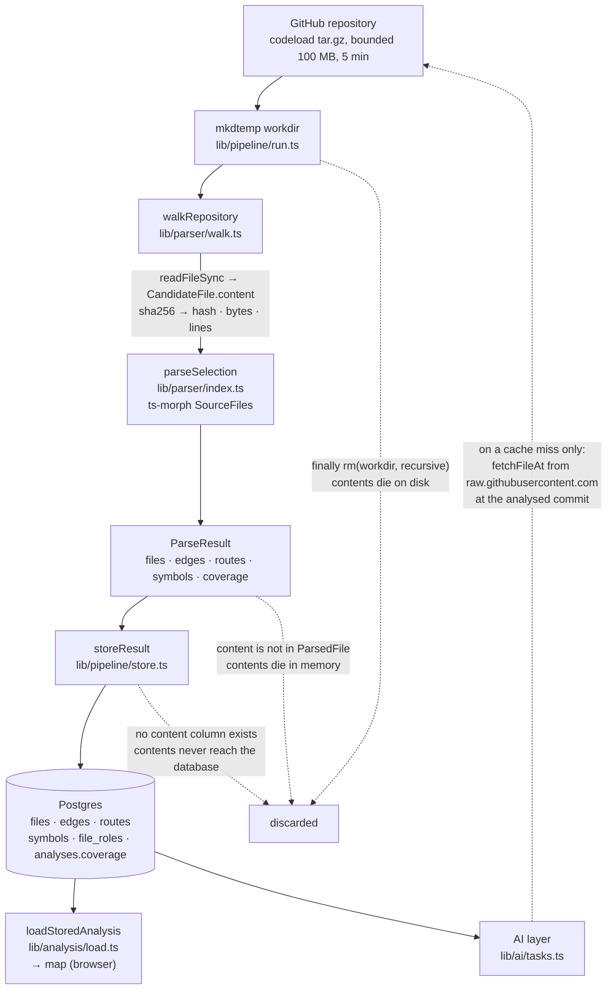
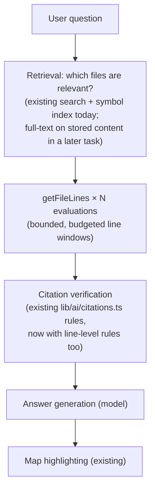

# Source-file content storage — feasibility and architecture

Status: **Designed; the storage foundations are implemented (§14), the pipeline
writes content during indexing (§15), and the read side with lazy backfill is
implemented (§16).** This document was written before any storage code existed.
It records what was verified in the code as of `SCHEMA_VERSION = 5`, defines the
requirements, compares the alternatives, and settles the design that
[ADR-0001](decisions/0001-source-content-storage.md) records as the decision.
[TODO.md](../../TODO.md) §3.4 carries the implementation tasks.

The problem in one line: **Cartograph analyses a repository and throws the
contents away.** Everything downstream — explanations of code, future Q&A,
full-text search, line-precise citations — subsequently has to borrow the
contents back from GitHub, one file at a time, on a network call that may not
succeed.

---

## 1. Existing architecture analysis

### 1.1 The lifecycle, traced in code



Where each of the file's bytes lives, and for how long:

| Lifetime | Where | Outcome |
|---|---|---|
| **~1 memory copy** | `readCandidate` (`lib/parser/walk.ts:187`) reads every file, keeps `CandidateFile.content`, and computes `sha256 → hash` (`walk.ts:217`) | All candidates (contents of the whole repository) are held at once — a documented limitation |
| **In memory, longer** | `parseSelection` (`lib/parser/index.ts:39`) feeds every content into ts-morph `createSourceFile` | Lost when the function returns: `ParsedFile` (`lib/parser/types.ts:12`) has `path, module, lines, bytes, hash, fanIn, fanOut, reachedBy, role, exports` — **no `content`** |
| **On disk** | `mkdtemp` workdir (`lib/pipeline/run.ts:40`) | `finally { rm(workdir, { recursive: true, force: true }); }` (`run.ts:86`) — the extracted tree is deleted at the end of every run, success or failure |
| **In the database** | `storeResult` (`lib/pipeline/store.ts:20`) writes `files (…, hash, fan_in, fan_out, exports)` and cascading rows | **Never.** No content or text column exists in any of the 9 migrations. `files.hash` is the *only* trace of the bytes — a comparison key with nothing left to compare |

### 1.2 What the code does about it today

Because the AI layer needs source, it borrows it after the fact:

- **`sourceAtAnalysedCommit`** (`app/(workspace)/analyses/[id]/actions.ts`) —
  on a cache miss, `fetchFileAt` (`lib/pipeline/github.ts`) fetches one file
  from `raw.githubusercontent.com` at the analysed commit, and refuses to
  describe it unless `sha256(bytes) === file.hash`.
  *"Perhaps code that isn't on the map"* is exactly the failure the hash
  check prevents — and it is the only thing standing between the AI and a
  quietly-stale answer.
- `explainFile` caps source at `MAX_SOURCE_CHARS = 120_000`; `classifyFile`
  sends 60 lines; `explainFolder` sends **no source at all** — folders are
  explained from metadata only.
- Only the changed-neighbours freshness check (`fileAtHeadAction`) also
  fetches over the network, hash-compares, and discards the bytes.

### 1.3 The consequences to weigh (all verified in code)

1. **Every explanation costs a network round trip per miss.** GitHub rate
   limits and availability are now a dependency of the *product's* core
   answer path, not just of ingestion.
2. **A repository-wide Q&A is impossible as a question of engineering, not
   just a missing feature.** Retrieval over N relevant files means N live
   network fetches inside one answer, with a per-file hash check.
3. **An analysed commit can be deleted or force-pushed**; then every cache
   miss fails permanently, not just slowly.
4. **Citations promise line precision** (`Route.line`, symbols, edges are all
   line-anchored), yet nothing can *show* a line without the network.
5. Existing metadata is worth building on: `files.hash` already carries
   sha256 of the exact bytes, `files.lines` already carries the line count, so
   content-store integrity checks come free.

---

## 2. Requirements

### 2.1 Functional

| # | Requirement | Why |
|---|---|---|
| F1 | Retrieve complete contents of any parsed file by **file ID** and by **repository-relative path** | Q&A retrieval, explanations, export |
| F2 | Retrieve a **line range** by 1-based inclusive numbering that matches the parser's recorded line numbers exactly | Citations must show the line they cite |
| F3 | Associate content with the correct **organization** and **analysis**, with the same isolation the rest of the data has | Tenant isolation is a verified guarantee elsewhere |
| F4 | Keep content consistent with **`files.hash`** — verified, never assumed | The hash check in `sourceAtAnalysedCommit` encodes the product's rule: describe only code that was parsed |
| F5 | Support **re-indexing**: a new run of the same analysis must not double-store or corrupt old content | `storeResult` already deletes-and-reinserts `files` rows |
| F6 | Support **deletion** of analyses/projects without leaking content rows indefinitely | Ordinary tenancy hygiene |
| F7 | Handle files that were **skipped** (declaration, binary, too-large, unreadable, syntax error) as first-class non-retention | The corpus proves these are common, named states |
| F8 | Serve **future Q&A retrieval**: many files per answer, with per-file line-ranges | §7 |

### 2.2 Non-functional

| # | Requirement | Bound informed by code |
|---|---|---|
| N1 | **Low-latency reads** of content in answer paths | ≤ a file's parse-equivalent in wall time; DB read must beat a GitHub fetch |
| N2 | Bounded **memory** usage at read time | Max per-file read = the parser's own `MAX_FILE_BYTES = 1 MB` (`walk.ts:13`) |
| N3 | **Scalable indexing** of 10k–100k+ files, without holding all contents on the write path | Pipeline already chunks inserts; content writes must chunk the same way |
| N4 | Large-file safety | Refuse ≤ parser's 1 MB rule; keep *no* partial contents |
| N5 | **Atomicity** per run | Reuse the run's existing fencing (`started_at` claim) rather than inventing a second mechanism |
| N6 | Crash recovery | A run dying mid-write must not leave half-read state; orphaned content is collectable |
| N7 | Content integrity | Hash-keyed identity (F4) plus size on the row |
| N8 | **Reasonable storage cost** | Bounded by the existing `MAX_ARCHIVE_BYTES = 100 MB` archive cap per run — a repository cannot bring more than that onto the system |
| N9 | **Cross-platform** server support | Next.js server (Node), Postgres/Supabase — no new infrastructure products required for the first version |

### 2.3 Explicit non-goals

- **Not** full-text search index construction (Postgres GIN/`tsvector`) in
  this design — §3.4 tasks cover it as a later task on top of content storage.
- **Not** file history/versioning UI, diffs, or commit comparison.
- **Not** private-repository ingestion.
- **Not** multi-region or tiered archival storage.

---

## 3. Storage alternatives

Each option evaluated against the same criteria. The statuses quoted below
come from what the code actually does, not from how an option might work in
theory.

### Option A — Content in the existing database

`files` gains a (large) payload column, or a sibling `file_contents` table
does.

- **Size growth:** bounded by `MAX_ARCHIVE_BYTES` (100 MB *raw* per run) and
  per-file by 1 MB. But Postgres TOAST holds a *copy* per logical value per
  write; delete-and-reinsert churn on every re-run creates dead-tuple +
  TOAST-tracking pressure, requiring bigger autovacuum attention than any
  other table (the JSON `analyses.coverage` already shows how churn builds).
- **Read:** hash lookup by PK → one row → one TOAST compression read. For ≤1
  MB payloads this is very fast, and identical files deduplicate via the
  content table to one row.
- **Transaction consistency:** the decisive advantage. Content rows and the
  `files` rows which reference them live under the same RLS, the same backups,
  the same migration tooling. Deletion of an analysis cascades to referenced
  files; content GC is a matter of refcounts, not a second system to keep in
  step.
- **Backup:** single unified dump; cost grows but is capped by the archive limit.
- **Migration complexity:** one `CREATE TABLE` (the content table) + one
  `ALTER TABLE files` — small, reversible.

### Option B — Content-addressed local filesystem

A `var/contents/aa/hash` sharded tree written at index time, once per content
hash; read back by path.

- **Deduplication:** natural and free (once per unique hash).
- **Atomic writes:** temp file + rename — sound on POSIX, subtly
  non-atomic on Windows FFR (this project's own guidance is Windows-first dev,
  Linux deploy; must be handled explicitly).
- **Portability / concurrency — the disqualifiers.** The app is a Next.js
  server with multiple test suites running in-process, and *the server that
  wrote the content may not be the server that reads it* (new deploys are new
  machines). A local-only backend cannot be read by a horizontally-scaled
  deployment at all, and the current repo has no shared-volume primitive; the
  existing server actions run on whatever pod serves the request.
- **Cleanup:** GC by scanning when nothing references it; a maintenance job
  that isn't needed on any other option.
- **Backup:** an entirely separate backup target from the DB dump.

### Option C — Dedicated storage abstraction

`ContentStore` interface over concrete backends (Postgres today, S3 object
storage tomorrow). The interface is a good idea at the exact point the
transaction-bound backend stops being sufficient, but premature as the sole
architecture — without a second backend shipping, the interface would be
designed from imagination rather than from the needs of a real second
implementation. The spec's stated constraint against abstractions without
clear use cases applies. So Option C is folded into the recommendation as a
*weighted* future path, not chosen alone.

### Option D — Hybrid: metadata DB + content-addressed payload DB + process cache

**This is the recommendation.** Content-addressed rows inside the existing
Postgres (keeping transactional consistency and Supabase-native tenancy),
referenced by the `files` table's existing hash column, behind a module
boundary slim enough to swap for object storage when volume demands it, with
a bounded, hash-keyed process cache at the answer path.

### Comparison matrix

| Criterion | A: DB column(s) | B: Local FS | C: Abstraction now | D: Hybrid in-DB + cache (recommended) |
|---|---|---|---|---|
| Read performance | excellent for ≤1 MB blob by PK | excellent locally, terrible cross-pod | depends on backend | as A, plus hot reads cached |
| Write performance | single-chunk batched inserts, no extra service config | very fast | depends | as A; dedup means re-run writes only *changed* hashes |
| Storage efficiency | content-dedup at hash level; good | **best** (pure CAS) | depends | ≈ A (dedup at hash level) |
| Implementation complexity | low: one migration + module | moderate: shard, rename-atomicity, sync-up | high before payoff | moderate: one migration + module + a small LRU |
| Consistency (with existing tenancy) | **best** — same DB, same RLS, same transactions | two systems to reconcile | depends | **best** (same as A) |
| Crash recovery | orphan content collectable; run-fencing already exists | uncollected orphans | depends | as A |
| Backup | same single DB dump | separate target | depends | as A |
| Scalability (to 100k+ files) | bottleneck is TOAST churn on re-run; predicts needing S3 eventually | serverless / multi-pod deploy blocks entirely | designed-for | as A, within reach of the 100 MB/run cap |
| Future cloud / object storage | requires a second migration and a data move | rewrite | cheap to add | **cheap to add** — the module boundary is an explicit deliverable with a spec |

---

## 4. Recommended architecture

### 4.1 The decision in one paragraph

**Content is stored once per distinct file body, addressed by its existing
sha-256 hash, in a dedicated Postgres table (`file_contents`) inside the
current Supabase database; `files.content_status` records whether a file has
content; a thin module boundary (`lib/content`) mediates all reads and writes,
spec'd so that a future object-storage backend (Supabase Storage, an S3
bucket) can be swapped in behind the same functions; a bounded, hash-keyed
per-process LRU serves the answer path.** Content is immutable: nothing ever
rewrites a stored hash's payload, so concurrent indexing and re-indexing
cannot corrupt anything.

```mermaid
flowchart LR
  subgraph Index time
    PARSE[storeResult<br/>chunks of 1000] -->|"putContents: hash → payload<br/>ON CONFLICT DO NOTHING<br/>(idempotent, no double-store)"| FC[("file_contents<br/>org_id · hash PK<br/>payload bytea (compressed by TOAST)<br/>size · created_at, RLS by org")]
    PARSE -->|"files: existing columns<br/>+ content_status"| FILES[("files<br/>…(existing)…<br/>content_status")]
  end
  FILES -->|"hash = content reference"| FC
  subgraph Answer time
    SVC[lib/content/read.ts<br/>getFileContent(fileId)<br/>getFileLines(fileId, start, end)] --> FC[("file_contents<br/>org_id · hash PK<br/>payload bytea (compressed by TOAST)<br/>size · created_at, RLS by org")]
    SVC -.->|"on a 'absent' file: fetchFileAt<br/>at the analysed commit, hash-verified,<br/>then stored and flagged (§16)"| GH[("raw.githubusercontent.com<br/>at the analysed commit only")]
    SVC --> CIT["citation / Q&A paths (later)"]
  end
```

### 4.2 Why this beats the alternatives (justification)

1. **Transaction consistency with the tenancy model** is the one property the
   rest of the codebase has already earned the right to rely on
   (organization-scoped RLS on every table, verified by hand; the event
   trigger auto-enables RLS on new tables). Nothing else in the system
   requires server-code discipline to keep isolation true; a filesystem or
   external object store would introduce the first such exception. Content
   inherits isolation the same way `analyses.coverage` (jsonb) already does —
   by living inside the same tenant-perimeter policy.
2. **The existing 100 MB × 5 min archive caps** (`lib/pipeline/github.ts`)
   already bound the total content a run can add. A repository *cannot* bring
   more than ~100 MB of raw content into the system per analysis; that keeps
   the database-side answer defensible for years of growth without jumping to
   object storage.
3. **Content identity already exists for free**: `files.hash` is sha256,
   computed over the exact bytes the parser saw, before anything is dropped.
   Introducing a *different* identity scheme would be change for its own sake.
4. **Immutability solves the concurrency problems outright.** Two subscribers
   of the same repository, re-indexing concurrently, writing the same hash:
   `ON CONFLICT DO NOTHING` is correct, and a superseded run can never
   "overwrite" content rows another run legitimately inserted.
5. **The 5-minute stale window** on analyses (`STALE_AFTER_MS`,
   `lib/pipeline/stages.ts:23`) is five minutes; content rows keyed by hash do
   not participate in that staleness at all. A run that dies mid-write leaves
   orphaned content rows, which GC collects later — precisely the failure
   pattern the existing claim mechanism already tolerates for metadata.

---

## 5. Content identity and versioning

### 5.1 Identity model

```text
Repository (projects)
   └── Analysis (analyses)          commit_sha pins the run
        └── files (files)           path · hash — file identity
             └── body (file_contents) hash-keyed payload, immutable
```

- **File identity** is the `files` row — a (organization, analysis, path)
  tuple that changes whenever the analysis is re-run.
- **Content identity** is the `file_contents` row keyed by `(organization,
  content_hash)`. It exists independently of any file row that referenced it
  this run or last.
- **Versioning of a *file's* contents** is therefore not a chain of versions
  but a **reference change**: a re-run that found `foo.ts` different produces
  a *new* hash; the `files` row is re-inserted with the new hash; the old
  hash's content row briefly loses its only referent and is collected (§5.4).
- **Multiple files with identical bytes** (empty files, LICENSE copies,
  exported boilerplate) collapse to one stored row.
- **Across analyses**: two commits that share an unchanged file share one
  content row. Org-scoped dedup: the same file in the same org costs once;
  brought in by a *different* org, it costs again. (Whether to share across
  orgs trades multi-tenancy simplicity for size; §8 recommends deferring.)

### 5.2 Why content should be immutable and hash-addressed

- Re-running an analysis is a delete-and-reinsert of `files` rows today
  (`storeResult` deletes first — verified in `store.ts:22`). If content were
  stored *inside* the files rows, every re-run would tear down and rebuild
  every payload; with dedup-by-hash, a re-run that re-parse the same code
  writes essentially nothing (a no-op `ON CONFLICT`).
- Immutability lets the **statement "content X is intact"** be checked in
  constant time (sha the bytes when paranoid, compare sizes always).
- Immutability is what proves the *stale-citation* guarantee: citations bind
  to `(file_id, content_hash)` — if a re-run changes the hash, the citation
  can be marked stale without re-reading content (§7).

### 5.3 References and stale references

A "stale reference" (a `files` row pointing at a hash with no payload; or a
payload with no referencing file) is *not an error* in this design, it's a
scheduled state:

- File row awaiting its payload (delayed backfill, §7): `content_status` says
  `'absent'`; the read path responds with a typed miss, not a crash.
- Payload with no referers: GC's target (§5.4).
- A read that finds a missing payload for a `'present'` row is a bug and
  throws — not silenced.

### 5.4 Concurrent indexing / re-indexing

The current claim run (analyses' `started_at` fence, `STALE_BEFORE_MS`) is
unchanged. Content writes are safe regardless of which run executes them:
`insert … on conflict do nothing` keyed by hash is idempotent and additive.
The existing debt item *"parser's data writes are not fenced by the run's
claim"* (see TODO §1.5) — for `file_contents` this debt *does not apply*,
which is another argument for the content table being hash-keyed rather than
analysis-keyed.

### 5.5 Cleanup of old versions

- A scheduled job deletes content rows whose hash has **zero referencing
  `files` rows**. Because the write path is hash-inserted *before* file
  references, a minute-level GC delay is safe in the worst case and harmless
  in the expected case.
- Alternatives considered: (a) delete-old-not-touched-within-N-days, and
  (b) pure-lazy collecting — both rejected as either over-engineering (no
  demand for N-day history today) or leak-prone (a never-invoked sweep).
  Explicit refcount-GC at 24 h cadence is the recommendation.

---

## 6. Size limits, retention policies

What the parser already refuses (`walk.ts`):

| Category | Existing handling | Storage decision |
|---|---|---|
| Small source files (< 1 MB) | fully parsed, fully hashed | **stored fully**; this is the normal case |
| Large source files | `> MAX_FILE_BYTES = 1 MB` → skipped as `too-large`, always was | **not stored** — no partial-store: the parser never saw the tail, so storing a prefix would silently claim more length than is analytically true |
| Binary (NUL bytes) | skipped as `binary` | **not stored** — no viewer, no citation |
| Invalid UTF-8 | *not* rejected — Node `toString("utf8")` substitutes; the parser counts lines on the utf8 string | stored as **raw bytes** (`bytea`), so re-reads use the same decode as the parser did; the decode is the publisher's, not the storage's problem |
| Empty files | valid candidate, `lines: 0` | stored (dedup across many empty files to one row) |
| Declaration files | skipped as `declaration-file` | **not stored** — types only, no runtime import graph, no citation target |
| Readable-would-fail at read time (perms) | skipped as `unreadable` with the OS's message | **not stored** |
| Files inside excluded directories (`node_modules`, `.next`, nestjs `dist`) | never walked | **not stored** — never *saw* them |
The recommendation is therefore simply: **`file_contents` holds exactly and
only the payloads of files that `ParseResult.files` contains**, and nothing
the parser skipped, ever.

1. **Maximum indexable file size:** 1 MB — inherited, unchangeable, not a
   new policy.
2. **Maximum stored content size:** 1 MB per row; 100 MB aggregate per run
   (inherited).
3. **Oversized files:** skipped, *not* partially indexed. Rationale: a
   citation claiming line 1–800 of an 11 MB file would cite beyond what the
   parser analysed.
4. **Binary content:** never stored. (It would also be parsed-skip today.)
5. **Compression:** at the app layer — **no** in the first version; rely on
   Postgres TOAST (defaults to `pglz`, can change a column to `lz4` on
   Supabase's PG ≥ 14 by `ALTER TABLE … ALTER COLUMN payload SET COMPRESSION
   lz4`, an Existing-tooling change, not a dependency). Source code is
   textbook TOAST material (highly repetitive ASCII), measured compression is
   a benchmark, not an assumption (§10).
6. **Old versions retained?** Only via dedup-supersession: a hash that
   nothing references anymore is *not* kept (policy §5.4). Deliberate
   archival of "every version ever indexed" is out of scope (someone would
   have to own a source-of-truth for history).
7. **Garbage collection:** refcount-based (`files` rows referencing a hash),
   scheduled 24 h; documented in §5.4 above.

---

## 7. Cache architecture

### 7.1 What exists today

- **Browser-side** `explanation-store.ts` (`sessionStorage`) *does* have an
  eviction policy: `LIMIT = 100` answers, oldest-first. Verified. The often-
  quoted "nothing evicts" target is the **DB-side `ai_cache`** — no TTL, no
  delete, anywhere (`docs/security.md §9.6` confirms). This design does not
  touch `ai_cache` (out of scope).
- **Per-request** in-flight memoization of a single file's source already
  exists: `sourceAtAnalysedCommit` wraps its fetch in a `pending ??=`
  Promise, fetched once per request. The proposal buys a *cross-request*
  persistence layer for content that never needs re-fetching.

### 7.2 Proposed: bounded LRU keyed by `(fileId, hash)`

- **Eviction strategy:** LRU over Map ordering. Nothing about this workload
  justifies LFU/arc/segmented-LRU: hot resurrect pattern is absent, and
  simple LRU survives an implementation review.
- **Maximum memory budget**: `32 MB` process-wide. Chosen to comfortably hold
  > 500 of a 6 KB-estimated, ~1 MB-max file at once (§10 estimate) without
  competing with the graph-render path for heap.
- **Maximum cached entry size:** full `MAX_FILE_BYTES` = 1 MB. Entry > 1 MB
  is *impossible by the size policy*, so entry size needs no second cap.
- **Invalidation:** the key strictly includes the content hash. A re-index
  that changes the hash produces a *different key* — no purge protocol is
  needed for correctness because stale entries become dead weight, evicted
  naturally by LRU. A GC'd hash's entry is just unreachable garbage.
- **Concurrent reads:** the entry is an immutable string + small envelope; no
  locking required. Async coherence on same-key misses is desirable (single
  in-flight promise per key) but *not the first version's* complexity — the DB
  is the source of truth and misses are cheap.
- **Repository switching:** nothing to do — keys are per-(file-id/hash),
  which transitively scope per-analysis and per-org.
- **Metrics:** hit count, miss count, bytes evicted, budget-highwater.
  Exposed via existing `posthog`-equivalent diagnostics? Not currently in
  scope of any consumer; `requirement` here only says log at debug in dev and
  assert total budget never grows past 32 MB in tests.

### 7.3 Consistency when contents change

The cache holds `(fileId → hash)` and the file row holds `hash`; a re-index
updates the file row, so the next lookup computes a new cache key and misses.
Two pathological cases to document explicitly:

1. *Cache holds content for a hash that the next request removed from the DB
   entirely* → the cache is a read-through with a DB fallthrough; the stale
   hash is never *served as authoritative*, it is only served with its own
   hash name attached, so any caller still needs to elect the **file's**
   current hash to be "the content I'm citing". The design's citation-binding
   covers this precisely (§8).
2. *Two processes (multiple Next.js pods) cache independently* → harmless;
   each sees its own LRU, and both miss on any genuinely-current hash change
   since the same DB row is the truth.

---

## 8. Database & API design

### 8.1 Schema (illustrative SQL, not to be applied yet)

```sql
create table file_contents (
  organization_id uuid not null references organizations (id) on delete cascade,
  content_hash    text not null,                 -- sha256 hex; identity, never rewritten
  payload         bytea not null,
  size            bigint not null check (size between 0 and 1048576),  -- MAX_FILE_BYTES
  created_at      timestamptz not null default now(),
  primary key (organization_id, content_hash)
);
alter table file_contents enable row level security;
create policy file_contents_read on file_contents for select to authenticated
  using (organization_id = coalesce(auth.jwt()->'o'->>'id', auth.jwt()->'org_id'::text));
-- insert policy mirrors the other tables' pattern (members never write in practice; the writer's service role bypasses RLS)

alter table files
  add column content_status text
  check (content_status in ('absent', 'stored')) default 'absent';
-- files already carries `hash`, which *is* the content reference. No new
-- FK between files.hash/file_contents is created — the GC refcount decides
-- integrity, and dropping the FK lets a content row outlive a *deleting*
-- chunked file-batch safely during a run.
create index file_contents_gc_hash on file_contents (organization_id, content_hash);  -- PK serves lookups; GC uses the reverse scan on files (below)
create index files_gc_hash on files (organization_id, hash);  -- reverse lookup for refcount/GC
```

Deliberately *not* added: `content_encoding` (bytes are bytes; decode is the
read path's policy), `content_storage_key` (the hash **is** the key while the
backend is Postgres; a future S3 backend would want it), any reference from
`explanations`/`ai_cache` to content (§7 explicit non-goal for now), and any
`analysis_id` on file_contents (multi-analysis dedup by design).

### 8.2 Library boundary — `lib/content`

The spec's `put/get/delete/exists` interface, adapted to the codebase's
conventions (chunked writes belong in the store path; reads return `null` not
errors for absent content, errors only on transport/DB failure, as existing
`lib` functions do):

```ts
// lib/content/store.ts — write-side, called from the pipeline
export type ContentPut = { hash: string; bytes: Uint8Array };

export interface ContentStore {
  // Chunked, idempotent, hash-addressed.
  putContents(organizationId: string, contents: readonly ContentPut[]): Promise<void>;
  // NULL = no such content (caller checks files.content_status / hash)
  getContent(organizationId: string, contentHash: string): Promise<Uint8Array | null>;
  existsContent(organizationId: string, contentHash: string): Promise<boolean>;
  deleteOrphaned(organizationId: string): Promise<number>;  // GC, §5.4
}

// Postgres-backed in v1; an S3/Supabase Storage variant implements the same 4 calls.
```

```ts
// lib/content/read.ts — read-side, called from server actions and future API routes
// Implemented as of Phase 3 (see §16).
export type BackfillDeps = {
  /** The writer client for content and metadata; defaults to the admin client
   *  (createAdminSupabase) — members have no write grant on files/file_contents. */
  writer?: Db;
  /** One file's bytes at one commit; injectable for tests, defaults to the
   *  pipeline's commit-pinned fetchFileAt. */
  fetchFile?: typeof fetchFileAt;
};

export async function getFileContent(
  db: Db,
  fileId: string,
  deps?: BackfillDeps,
): Promise<string | null>;  // whole file, utf8-decoded exactly as the parser read it

export async function getFileLines(
  db: Db,
  fileId: string,
  startLine: number,
  endLine: number,
  deps?: BackfillDeps,
): Promise<string | null>;  // 1-based, inclusive, parser-coincident line numbers

export type FileSource = {
  fileId: string;
  path: string;
  contentHash: string;
  text: string;
  lineCount: number;   // the parser's countLines, shared with lib/parser/walk.ts
};
```

Rationale for the shape:

- **File-id-first reads** get content *through* a live `files` row, so
  citation-verification and staleness fall out of one query, not two.
- **Line-ranges are surfaced, not a full-file API**: the read path
  demonstrates the whole-file fetch is *not the prevalent Q&A need* (retrieval
  wants windows), and surfacing `getFileLines` at this layer keeps the
  *line-numbering contract* (1-based, parser-coincident) in one place for the
  next consumer to inherit rather than re-derive.
- **No answer-path cache this phase.** `lib/content/read.ts` reads the
  database every time; §7's bounded LRU stays proposed, not implemented. The
  `getFileLines(fileId, startLine, endLine)` and `ContentStore` calls above
  are deliberately minimal; **no** `Stream` API is proposed — payloads are
  celestially ≤ 1 MB, so streaming to the web response is a later trade-off,
  not a need.

---

## 9. Retrieval and citation readiness — the future pipeline



What the design must guarantee, and does:

| Question | Design answer |
|---|---|
| Full-file retrieval | Yes — `getFileContent(fileId)` |
| Line-range retrieval | Yes — `getFileLines`, 1-based inclusive, parser-coincident |
| Exact line numbers | Yes — parser produces line numbers from utf8 counting that `walk.ts` defines; the read side uses the *same decode*, so line N is line N everywhere |
| Stable file identity | Yes — `files.id` is the identity used by everything else already |
| Content-hash verification | Yes — `files.hash` and `file_contents.content_hash` must agree, `73` bytes expected hash format; no content row read is completed without either trusting the pair's key equality *or* hash-verifying the re-read |
| Citation validity after re-indexing | **Binding, not content-snapshot**: citations must record `(fileId, content_hash)`. After a re-run that changed the hash, a cached answer whose citation names an old hash is stale **already and detectably** |
| Detection of stale citations | The same citation-verification pass whose rules are `lib/ai/citations.ts` today would gain a rule: *any path cited with a bound hash that the current analysis does not record is flagged and refused, i.e. the AI layer never serves it* (matching the existing "refuses and never caches" rule for a bad path — hard-coded behavior in `tasks.ts`, not an advisory) |

**This is the design's load-bearing guarantee against the *stale-citation*
failure, stated up front:** the *product rule* adopted earlier — the model may
not describe code that isn't on the map — is enforced across a re-index by
(in order of preference) (a) bind citations to `(fileId, content_hash)` when
the answer is emitted; (b) on read-through, verify the bound hash matches the
current file row before showing content-derived lines:

> If (b) fails: answer is stale, re-computed or refused — never abbreviated silently.

---

## 10. Performance and capacity estimates

**Labeled as estimates; none of this has been measured yet.** Assumptions:
avg raw source file **6 KB**; TOAST/`pglz` compresses repetitive source ~
**2.5–3×**; per-file DB metadata ≈ **600 B** (files row + edge/route/symbol
proportion excluded from these figures); per-row overhead ≈ 10%.

| Scale | Raw content | Estimated stored (compressed, deduped ~5%) | `files` metadata | Notes |
|---|---|---|---|---|
| 10,000 files | 60 MB | ~22–26 MB | ~6 MB | Comfortably within Supabase free-tier DB |
| 50,000 files | 300 MB | ~110–130 MB | ~30 MB | TOAST-copy and index overhead dominates |
| 100,000 files | 600 MB | ~220–260 MB | ~60 MB | Approaching the scale where Supabase Storage/S3 becomes the correct backend (still < 1 GB) |

**Cache**: 32 MB budget ≈ 5,300 avg-size files in-process, or ~1–2 full-hot
paths for a mid-size repository — enough for an answer session's *working
set*, small enough to forget about as a leak.

**Read/write pattern shape:**

- Writes: bulk-sequential at index time (chunk 1000, aligned with the
  existing `FILE_CHUNK`), interleaved server impacting other writes minimally;
  dedup makes re-indexed-unchanged branches near-zero-write.
- Reads: bursty, few-at-a-time (answers need N files then lines); full content
  for a ≤1 MB payload loads from TOAST as a single block — a line-range read
  still pays for the whole payload decompression, i.e. **line-ranges are
  correctness/UX cheap but *not* DB-traffic-cheap** — worth knowing and
  worth benchmarking before promising token-count-tight Q&A at scale.

### Benchmarks to implement before production rollout

1. **Index-time content write throughput** on a 10k-file real repository
   (the metric that protects the pipeline's 5-minute budget).
2. **p95 `getFileLines`** over hot and cold cache for a 100 KB and a 1 MB
   file pair (the metric the answer path will depend on).
3. **Measured compression ratio** on a real corpus (validates §6.5's
   "rely-on-TOAST" before shipping the estimate as policy).
4. **DB size after N re-run cycles** on the same repo (validates that
   dedup-then-GC holds storage static rather than creeping).
5. **Concurrent re-index + read mix** throughput (validates the claimed
   no-content-contention immutability story).

---

## 11. Migration strategy

Three options, recommending the second:

1. **Big-bang re-index of existing analyses** — *rejected*: forced re-writes
   of every organization's analyses to gain an *optional* capability, with
   heavy churn or else a broken 5-minute window.
2. ✅ **Lazy backfill at first read** — *recommended*: every read path that
   finds `content_status = 'absent'` for a hash-recorded file uses the
   *existing* `sourceAtAnalysedCommit` machinery (fetch from GitHub at
   analysed commit, hash-verify, then write a `file_contents` row through
   `putContents`), so content solidifies into the store the first time
   anything asks for it; no separate utility, no painful unlock.
3. **Background bulk backfill of all existing analyses** — *deferred*: a
   `file_contents` sweep driven by an admin script becomes useful only if
   lazy backfill's first-question-latency at some org proves unacceptable,
   and we shouldn't build that sweep without that data.

Rollback, interruption, partial failure: an interrupted lazy backfill leaves
some files `'stored'` and at least one `'absent'` — a state the system already
tolerates by design (§5.3), *not* a crashed migration. Rollback means dropping
the new table and column; no other migration references it yet.

Backward compatibility: `schema_version` bumps from 5 to 6 for the parse
contract only if the *parse* result changes (it doesn't here: `ParsedFile` is
unchanged; content is orthogonal). The existing re-run flow
(`storeResult`'s delete-first) needs only *one* edit to write content in the
same pass — covered by the tasks list.

---

## 12. Risks and trade-offs

| Risk | Assessment | Mitigation (design-level, present tense) |
|---|---|---|
| TOAST `pglz` ratio disappointing | *estimates only*; source code may be friendlier to a different codec (lz4 vs pglz tradeoff is write-once copyright) | §10 benchmark 3 before policy-shifting; column compression is a one-line `ALTER` |
| Re-run delete-and-reinsert churn (dead TOAST) | the existing `storeResult` model's known anti-pattern, magnified by payload bytes | content is *insert-only* by hash-key — the churn lands at `files` rows, not payload relocations |
| PostgREST/pooler response-size edge on 1 MB reads | unlikely but unproven | benchmark 1 covers it; falls back to ranged chunks in a later task if real |
| RLS on many-row bulk `putContents` vs admin-client write pattern | existing `cacheFor` write already goes through `createAdminSupabase()` | same pattern applies; *members never write* content |
| Multi-tenant cross-org identical content duplication | documented, deliberate (§5.1) | revisit only once total-DB < free-tier becomes a constraint |
| Process cache budget on serverless/varying instance memory | single Node process is today's runtime | 32 MB is small relative to current heap pains; metrics assert the bound |
| Stale-content / citation mismatch after re-index | primary product risk this design exists for | binding `(fileId, content_hash)` at citation-emit + read-through verify (§9) |
| Content table without FK is a GC-integrity risk | written content before referencing file row leaves orphans — deliberately (§4.2.5) | refcount-GC at 24 h cadence; a "content exists but file row says `'absent'`" state is a typed, searchable condition, not a bug-shadow |

### Explicitly deferred decisions (recorded as risks-to-write-down)

- Whether to *share content rows across organizations*.
- Whether `ai_cache` answers should ever *bind* their own content hashes
  (touches the prompt-injection strategy too — out of scope here).
- Object-storage backend trigger point (DB size threshold unmeasured).

---

## 13. Summary

The recommendation is **Option D**: an immutable, hash-addressed content
table in the database the system already trusts, a slim module boundary
(`lib/content`) spec'd for a later object-storage swap, a bounded LRU at the
answer path, and lazily-backfilled content for existing analyses. The system
inherits transactional consistency, tenancy, and integrity it already has;
the answer path stops depending on GitHub's availability; future Q&A gets
line-precise content with staleness *detectable*, not silent.

[ADR-0001](decisions/0001-source-content-storage.md) records this decision.
[TODO.md §3.4](../../TODO.md) lists the implementation tasks with priorities,
effort, dependencies and acceptance criteria.

---

## 14. What is implemented so far (October 2026)

The database foundations and the storage module exist; everything built on
them — the pipeline's write, the read side, backfill, cache, GC, benchmarks,
hash-bound citations — does not yet, exactly as §3.4's remaining tasks
describe.

### 14.1 Migrations

- `20261030040722_file_contents.sql` — the table, its checks, the immutability
  trigger, the grants and read policy, `files.content_status`, and the
  reverse-lookup index on `files (organization_id, hash)`.
- `20261030041425_file_contents_organization_scope.sql` — the foreign key the
  first migration should have had:

  ```sql
  foreign key (organization_id) references public.organizations (id) on delete cascade
  ```

  which keeps content scoped to and cleaned up with its organization in SQL,
  as every other table is. Both are applied to
  the linked project; existing `files` rows default to `content_status =
  'absent'` and nothing else changed on them.

The schema as implemented:

| Column | Type |
|---|---|
| `organization_id` | `text not null`, FK to organizations, cascade |
| `content_hash` | `text not null`, check `^[0-9a-f]{64}$` |
| `payload` | `bytea not null` |
| `size` | `bigint not null`, check `size >= 0 and size <= 1048576` |
| `created_at` | `timestamptz not null default now()` |

Primary key `(organization_id, content_hash)` — dedup is a primary-key
guarantee, and isolation is a row-policy guarantee.

### 14.2 Deviations from this document and ADR-0001

- **`organization_id` is `text`, not `uuid`** — the Organizations table is
  Clerk ids, and every other table keys them as text. The ADR's uuid came
  from the original proposal; the convention here won.
- **`putContents` was not chunked until the pipeline writer arrived** —
  this document's §8 sketches `putContents(organizationId, readonly ContentPut[])`
  for the pipeline's store phase. The Phase-1 implemented primitive was one
  body per call (`putContents(db, organizationId, content)`); Phase 2 added
  the batched form the pipeline actually drives — `putContentsBatch`, several
  bodies in one conflict-safe request — and the singular function is now a
  one-body delegation to it, so the hashing/validation/upsert logic exists
  exactly once. The chunk *policy* lives with the pipeline's chunking
  discipline (`CONTENT_CHUNK_FILES` / `CONTENT_CHUNK_BYTES` in
  `lib/pipeline/store.ts`), because that is where every other chunk constant
  lives.
- **`deleteOrphaned` is a contract, not a function** — its signature and
  conditions are written into `lib/content/types.ts` and nothing calls it;
  the migration's trigger blocks *updates only*, so a future GC can delete
  without dropping the trigger. Documented as such in both files.
- **Immutability is a trigger** — `UPDATE` is refused in the schema
  (`preserve_file_contents`), not just by the application's upsert
  discipline, as §5.2 argues it must be.

## 16. Phase 3 — the read side and lazy backfill, as implemented (October 2026)

`lib/content/read.ts` exists and TODO §3.4's read-side tasks are done:
`getFileContent(db, fileId)` and `getFileLines(db, fileId, startLine, endLine)`,
both hash-verified, organization-scoped through the file row's own
`organization_id` (never accepted from a caller), with lazy backfill through
the existing `fetchFileAt` path — no new GitHub fetching, no new PR.

### 16.1 API

```ts
export type BackfillDeps = {
  writer?: Db;          // defaults to createAdminSupabase lazily
  fetchFile?: ...;      // defaults to lib/pipeline/github.ts's fetchFileAt
};

export async function getFileContent(db: Db, fileId: string, deps?: BackfillDeps): Promise<string | null>;
export async function getFileLines(db: Db, fileId: string, startLine: number, endLine: number, deps?: BackfillDeps): Promise<string | null>;
export type FileSource = { fileId, path, contentHash, text, lineCount };
export { ConsistencyError, IntegrityError };  // from lib/content/types.ts
```

`db` is the caller's client — server actions pass the member client, so RLS
holds; scripts pass fakes or the admin client. Both functions share one
internal load (`loadSource` → `FileSource`), so content is fetched at most
once per call and never fetched twice after a successful backfill.

### 16.2 Read rules

1. **Resolve the file row under the caller's policies** — nested select
   `files → analysis:analyses(commit_sha, project:projects(repo_owner,
   repo_name))`, `.eq("id", fileId).maybeSingle()`. Missing row ⇒ `null`;
   `hash === null` (a file the parser skipped) ⇒ `null`. Another
   organization's file is not there at all — the row itself was filtered by
   RLS before its `organization_id` was ever trusted.
2. **`content_status === 'stored'`** ⇒ `getContent(organization_id, hash)`
   verifies hash and size. Missing row ⇒ `ConsistencyError` (a database that
   contradicts itself is not smoothed into a null). Corrupted payload or bad
   size ⇒ `IntegrityError` from the store.
3. **Unknown `content_status`** ⇒ `ConsistencyError` — the schema permits
   only `absent`/`stored`; anything else is a contract failure, loud.
4. **`content_status === 'absent'`** ⇒ first check the content table anyway:
   a backfill that wrote content but died before flipping status leaves this
   exact state, and a concurrent backfill may have landed. Verified bytes are
   served, the flip is retried, and a failed flip warns (`console.warn`) and
   serves — bookkeeping failure never rejects a verified read.
5. **Absent and nothing stored** ⇒ lazy backfill:
   - the repository and `commit_sha` come from the row's own analysis +
     project embed; missing either ⇒ `null` — truthfully unavailable, **never
     a default-branch or HEAD fetch** (commit pinning).
   - GitHub's bytes are sha256-compared to `files.hash` *before* anything is
     written; mismatch ⇒ `ConsistencyError`, nothing stored, nothing served
     (a stale substitute is the failure this phase exists to prevent).
   - `putContents(writer, organization_id, bytes)` — idempotent,
     `ON CONFLICT DO NOTHING`, the same call the pipeline uses — then
     `existsContent` confirms the write landed.
   - the metadata update is conditional:
     `.update({ content_status: "stored" }).eq("id").eq("organization_id")
     .eq("hash").eq("content_status", "absent")`. Zero rows touched ⇒ re-read
     the row: gone ⇒ `null` (the identity moved — re-index replaced it); hash
     changed ⇒ `null` (stale identity; its verified bytes stay stored,
     addressed harmlessly, GC later); otherwise ⇒ already stored, serve.
6. **Decode:** `Buffer.from(bytes).toString("utf8")` — the parser's own
   decode (same as `walk.ts`'s `readCandidate`), so line N here is line N
   there. Exact bytes: CRLF kept, trailing whitespace kept, no truncation,
   empty file returns `""`, never `null`.

### 16.3 Line numbering (`getFileLines`)

- 1-based, inclusive, matching `files.lines` exactly — `countLines` is
  exported from `lib/parser/walk.ts` and reused; no second convention exists.
- `sliceLines(content, startLine, endLine)` is exported for tests: split on
  `\n`, the trailing `""` a final newline leaves is not a line (the
  `countLines` adjustment), a per-line trailing `\r` is stripped (the
  ts-morph line-text view for CRLF files), lines join with `\n`.
- **Strict bounds:** `startLine` or `endLine` past the last line ⇒ `null`,
  never a clamped prefix and never silent truncation. Empty file ⇒ `null`
  for any range (it has no lines).
- **Rejected loudly** (`RangeError`): non-integers, zero or negative
  numbers, `startLine > endLine` — caller bugs, validated before any
  database work.
- Caveat, documented: a lone `\r` (old Mac line endings) is not a break in
  this convention, same as the parser's `countLines`; exotic files' line
  numbers can disagree with ts-morph's scanner — the read side follows
  `files.lines`, the parser's own.

### 16.4 Concurrency and idempotency

- Content writes are `ON CONFLICT DO NOTHING`; concurrent backfills both
  fetch (documented race — no distributed lock this phase), both write the
  same hash once, and the conditional metadata update is idempotent: one flip
  lands, the other matches nothing, and both serve their verified bytes.
- A row whose identity moved mid-backfill is never stamped `stored` by a
  stale backfill, and never serves stale bytes.
- Two simultaneous reads of the same absent file fetch twice and converge on
  one stored row; after a successful backfill, reads never fetch again.

### 16.5 What Phase 3 deliberately does not do (spec)

- No LRU cache (§7 stays proposed), no garbage collection
  (`deleteOrphaned` remains a contract, not a function), no full-text search,
  no retrieval/Q&A, no citation hash-binding, no object-storage backend, no
  background backfill jobs, no prefetching.
- `app/(workspace)/analyses/[id]/actions.ts` is **not** rewired: it keeps its
  own `sourceAtAnalysedCommit` (fetch at analysed commit, hash-verified,
  throws on mismatch, stores nothing) — deliberate, because storage belongs
  to the read path now and citation hash-binding is a later task.

### 16.6 Tests

- **`node scripts/test-content-read.ts`** (in `pnpm test`) — 66 checks
  against a fake of exactly the calls the read path makes: stored read with
  exact bytes and CRLF kept; missing file and skipped (hash-less) file ⇒
  `null`; empty file ⇒ `""`; org isolation through the row; corrupted
  payload ⇒ `IntegrityError`; stored-without-row ⇒ `ConsistencyError`;
  unknown status ⇒ `ConsistencyError`; absent-but-content heals and re-flips;
  line tests for first/last/single/multi/empty/CRLF/LF/trailing-newline/
  no-trailing-newline/invalid numbers/beyond-EOF; backfill happy path
  (analysed commit + exact repository + path, hash-verified, conflict-safe
  write, conditional metadata guard, second read refetches nothing); remote
  deleted ⇒ `null`; rate limit / network ⇒ transport error propagated;
  storage write failure ⇒ error, nothing flipped; unconfirmed write ⇒ error,
  retry heals; hash mismatch ⇒ `ConsistencyError`, nothing stored; two
  simultaneous backfills (documented race, one row, both served); row
  identity moved mid-backfill ⇒ `null`, new identity unstamped; row vanished
  mid-backfill ⇒ `null`; concurrent winner's flip stands; parser-agreement
  round-trip: a real fixture parsed by the real parser, its routes/symbols/
  edges read back at their recorded line numbers, and `files.lines` proven as
  the exact EOF boundary. Fakes prove nothing about RLS — that is the live
  suites' business.
- **`node --env-file=.env.local scripts/test-content-read-db.ts`** — the live
  linked project: happy backfill flagged `stored`, exact bytes back, second
  read refetches nothing, an outdated `'absent'` heals on read, a re-index
  racing the backfill yields `null` with nothing stamped, hash mismatch is
  refused as `ConsistencyError`, a path missing at the analysed commit is
  `null`. Seeds one throwaway organization plus its project, analysis, and
  file row; deletes the organization at the end and verifies zero content,
  files, and analyses rows with the test prefix remain. Deliberately not part
  of `pnpm test` (it touches the linked database).
- **`scripts/test-content-rls.ts`** and **`scripts/test-content-pipeline-db.ts`**
  — unchanged, both still green (member isolation and the batched bytea wire
  behavior respectively).
- Existing suites unchanged: `test-fixtures`, `test-provider`,
  `test-explanation-store`, `test-citations`, `test-symbols`, `test-search`,
  `test-content-store`, `test-content-pipeline`, plus `accuracy` — all pass.

### 16.7 Failure handling summary

| Situation | Behaviour |
|---|---|
| Missing file row / skipped file | `null` |
| `stored` row, nothing behind it | `ConsistencyError`, never `null` |
| Corrupted payload / wrong size | `IntegrityError` |
| `content_status` the schema does not define | `ConsistencyError` |
| Content present but status `'absent'` | verified bytes served, flip retried |
| Flip's metadata update fails | warned, bytes served, next read retries |
| GitHub has nothing at the analysed commit | `null` |
| GitHub's bytes hash elsewhere | `ConsistencyError`, nothing stored |
| Rate limit / network down | transport error propagated |
| Content write refused | error, nothing flipped |
| Write confirmed-missing afterwards | error, retry heals to `stored` |
| Row identity moves mid-backfill | `null`, stale identity unstamped, old content stays |
| Backfill race (two readers, two writers) | one stored row, both served, no lock |

Now, per [content-pipeline-integration.md](content-pipeline-integration.md)
Phase 2's record, §16 is this phase's record; together they are the
source-content storage feature's documentation, one PR (#2), one branch
(`ravi`), no merge until approved.

### 14.3 The module

```text
lib/content/types.ts   ContentReference, ContentKey, IntegrityError, ContentWrite,
                       ContentWriteResult, ContentStore, Db + the GC contract
lib/content/store.ts   putContents (one body; delegates), putContentsBatch
                       (the pipeline's driver), getContent, existsContent
                       + MAX_CONTENT_BYTES (= MAX_FILE_BYTES from lib/parser/walk.ts),
                       sha256, isContentHash
```

- **Write:** hash is computed from the exact bytes, never accepted from the
  caller; the row goes in via `upsert { ignoreDuplicates: true }`, so an
  existing body is never touched and a re-run of an unchanged file writes
  nothing. Anything over the parser's own 1 MB limit is refused here too —
  storage holds only what the parser parsed. Database errors surface as
  errors, never as silent success.
- **Read:** `null` when absent; otherwise the bytes are verified twice
  before being handed over — `sha256(bytes) === content_hash` and
  `bytes.byteLength === size` — and a mismatch throws `IntegrityError`
  rather than serving altered content as if it were the file. The class
  exists so callers can tell "not here" from "here but broken".
- **`existsContent`** selects `size`, never the payload.
- **bytea over the wire:** PostgREST carries bytea as a `\x…` hex literal;
  the store converts explicitly in both directions (`toPayload` /
  `fromPayload`). That is the transport's shape, not a storage decision —
  Postgres holds raw bytes and compression on them (§10's estimates) is
  unaffected.
- **Isolation is the database's, not the module's:** the write path works
  through the same admin client as every other pipeline writer
  (`lib/supabase/admin.ts`, service role, which bypasses row policies), and
  the read path filters by `organization_id` the way every other reader
  does. The module comments say plainly: that filter is a query convention,
  not the security boundary.

### 14.4 Row-level security, as applied

```sql
revoke all on public.file_contents from anon, authenticated;
grant select on public.file_contents to authenticated;
create policy "members read their organization's rows" on public.file_contents
  for select to authenticated
  using (organization_id = (select coalesce(auth.jwt() -> 'o' ->> 'id', auth.jwt() ->> 'org_id')));
```

Identical wording to what every other table uses. Writes have no grant and
no policy for members at all; the pipeline's writer uses the service role.

### 14.5 Tests and what they prove

- **`node scripts/test-content-store.ts`** (in `pnpm test`) — the store's
  own logic against a fake of the three calls it makes: identity from exact
  bytes, byte-for-byte round trip including non-UTF-8 bytes, empty bodies,
  dedup stays one row, organizations keep separate rows, absent reads,
  malformed-identity refusal, corrupted payload and wrong size both refuse,
  first-write-wins under a planted identity, oversized refuse, database
  failures surface. **It proves the module's contract, nothing more; its own
  header says so.**
- **`node --env-file=.env.local scripts/test-content-rls.ts`** — tenant
  isolation against the real database, which no fake can prove. One
  transaction seeds two throwaway organizations and one byte of content
  each, then exercises every access path as a member role whose
  `request.jwt.claims` match PostgREST's presentation, and as the writer.
  Ten checks, all passing on the linked project: a member sees only their
  organization's rows and reads a foreign hash as absent; every form of
  member write (insert, update, delete) is refused; the schema refuses a
  rewrite as postgres too; removal stays possible for a future GC; content
  cannot exist for an organization that is not there; deleting an
  organization deletes its content. The transaction never commits, and the
  driver verifies the database came out with zero content rows and zero
  test organizations. Deliberately **not** part of `pnpm test`, which must
  run without a connected database.
- **`lib/supabase/database.types.ts` was regenerated from the live schema
  after the migrations, per its own header instruction.**
- **`node scripts/test-content-pipeline.ts`** (in `pnpm test`) — the
  pipeline's content write against a real parser and a fake client, over a
  temporary fixture directory parsed for each scenario. Proves: every
  indexed file ends `stored` with content_status set only after its body is
  confirmed in `file_contents`; the stored bytes hash to the `files` row's
  hash and are byte-for-byte the bytes on disk; skipped files get no claim;
  chunked requests respect `CONTENT_CHUNK_FILES` and `CONTENT_CHUNK_BYTES`;
  duplicate bodies within a batch and across runs collapse with the stats
  counting the collapse; a refused content request fails only its own
  chunk's files (absent, counted), not the run; a metadata failure fails the
  run loudly while the content already written stays; a retried run repeats
  nothing and creates no second row; text that is not the round trip of the
  bytes (a file with a byte UTF-8 cannot express) is stored via the exact
  re-read fallback; a tampered/missing candidate text is verified-then-
  refused, never stored under an identity its body does not hash to.
- **`node --env-file=.env.local scripts/test-content-pipeline-db.ts`** —
  the wire behavior no fake can prove, against the live linked project: a
  batched bytea write (hex `\x` encoding over PostgREST) accepted, duplicate
  bodies collapsing inside one bulk request, byte-for-byte reads back,
  a no-write second batch, per-organization scoping. Cleans up by deleting
  its throwaway test organizations — the content follows them out by the
  foreign key's cascade — and verifies no row with a test organization id
  remains. Deliberately not part of `pnpm test`.

### 14.6 Failure handling summary

| Situation | Behaviour |
|---|---|
| Write fails in the database | Error with the message; state unchanged |
| Content over 1 MB | Refused before any request |
| Malformed hash on read/exists | `IntegrityError` before any request |
| Read misses | `null` |
| Payload does not hash to its identity | `IntegrityError`, never partial content |
| Size agrees differently | `IntegrityError` |
| Member writes by any path | Refused by grants/policy (and by nothing granted to change) |

---

## 15. Phase 2 — the pipeline write, as implemented (October 2026)

The indexing pipeline now preserves what it used to discard. The questions
the design left to the implementer, and how the code answers them, is
recorded in full in
[content-pipeline-integration.md](content-pipeline-integration.md); what
this section records is the shape, so this document stands alone.

### 15.1 Where the bytes come from

`run.ts` holds `selection` — the walk's candidates — when it calls
`storeResult`, and passes their texts keyed by path. `storeResult` treats
them as an *argument to verify, not bytes to trust*:

1. `Buffer.from(candidate.content, "utf8")` is hashed with the store's
   `sha256` and compared to the parser's `file.hash` (the walk's raw-bytes
   hash). Equal ⇒ the bytes are byte-for-byte the walk's originals — storing
   them cannot mismatch without a sha256 collision. No second read happens.
2. Not equal ⇒ the text was not the round trip of the bytes (a file with a
   byte UTF-8 cannot express): one exact `readFileSync` from the still-alive
   workdir, hashed and compared again.
3. Still not equal ⇒ the file changed under the run: nothing is written
   under the stale identity; the file stays `absent` and the run continues.

The candidate strings were already in memory (the parser holds them); the
map references them, so this adds no repository-sized copy.

### 15.2 The write

- Batching is `putContentsBatch(db, organizationId, writes)`: one
  conflict-safe bulk upsert per call (`ignoreDuplicates: true`, so an
  existing body is never rewritten), bodies hashed inside the store,
  duplicates inside a batch collapsed to one row. The singular
  `putContents` delegates to it.
- Chunking is the pipeline's, with the other chunk constants:
  `CONTENT_CHUNK_FILES = 25`, `CONTENT_CHUNK_BYTES = 4 MiB` (raw; hex wire
  ≈ 8 MB worst case). Requests are independent, *not* one transaction —
  same as every other chunked write in this file's pipeline.
- Sequence: clear this analysis's old `files` rows → write all content
  chunks → insert `files` rows with `content_status = 'stored'` only when
  the content row for that hash was confirmed during *this* run. The
  content-then-metadata order makes the §3 invariant hold by construction.
- Idempotent retries: content rows are `ON CONFLICT DO NOTHING`; a re-run
  repeats nothing, and a hash whose request failed is retried by the next
  chunk that carries it (a later batch of the same run), or by a whole
  re-run.
- A batch failure is *not* a run failure: the files of that chunk end
  `absent`, the rest land, the run completes and reports both counts. A
  metadata (`files`) failure still fails the run loudly, leaving content
  rows written but unreferenced — the documented pre-GC state.

### 15.3 Observability

`storeResult` returns `ContentStorageStats`:

| Field | Meaning |
|---|---|
| `eligible` | files the parser indexed (all were candidates for storing) |
| `stored` | of those, files whose content is confirmed in `file_contents` |
| `bytes` | raw bytes sent in confirmed writes (each distinct body once) |
| `deduplicated` | writes skipped because the body was confirmed earlier this run or collapsed within its request |
| `absent` | eligible files left `'absent'` |
| `failed` | of the absent: a database request was refused, or no text arrived for the path |
| `changed` | of the absent: neither the text nor a fresh read hashed to the parsed identity |
| `unreadable` | of the absent: the fallback re-read itself failed |

`run.ts` folds them into the final stage message — e.g. *"…; content stored
for 1,024 files, 3 files without content"* — beside a `console.warn` per
refused chunk (rate: per batch, never per file, and never any source text).

### 15.4 What Phase 2 does not do (still true)

Lazy backfill, the read service, LRU, GC, full-text search, retrieval/Q&A,
citation hash-binding, object storage, background jobs — all deferred, as
the tasks list says. `deleteOrphaned` remains a contract, not a function.
