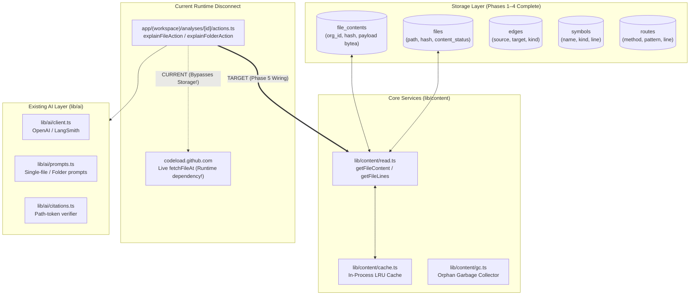
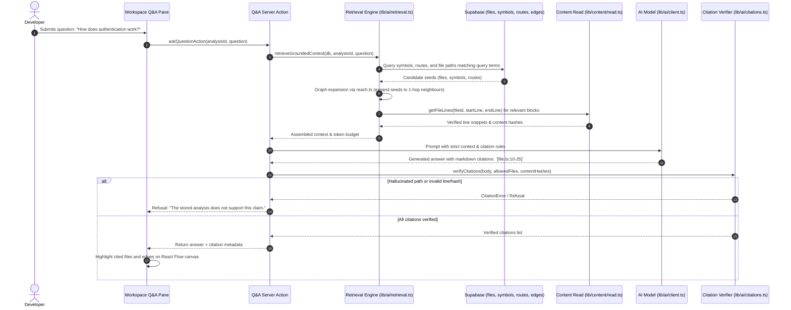
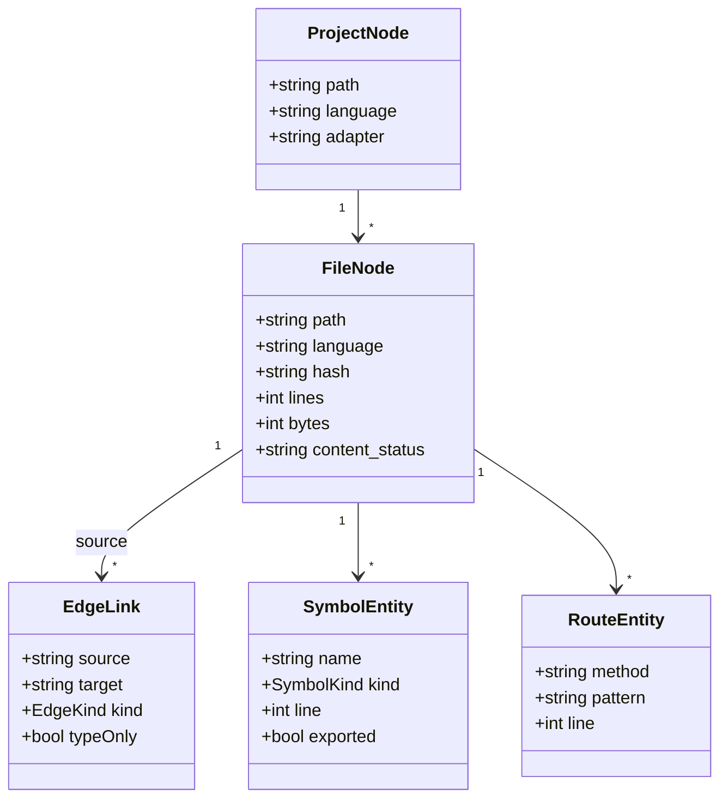
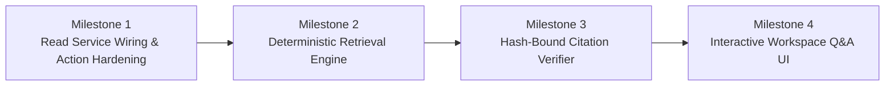

# Phase 5 Proposal: Repository-Wide Grounded Question Answering & Hash-Bound Retrieval

## 1. Executive Summary

Cartograph (Anatomy) has achieved a solid engineering foundation:
1. **Accurate Static Parsing:** AST-based extraction of imports, exports, routes, and declarations with zero hallucinated edges and an observed F1 score of 1.0 against ground truth (`fixtures/accuracy.json`).
2. **Interactive Visual Canvas:** Folder hierarchy folding, neighbour detail, and deterministic blast radius computation rendered via React Flow and Dagre.
3. **Multi-Tenant Security & Realtime Orchestration:** Strict PostgreSQL Row-Level Security (RLS) driven by Clerk JWT organization claims and Supabase Realtime progress streaming.
4. **Content-Addressed Source Storage (Phases 1–4):** Deduplicated, immutable `file_contents` storage in PostgreSQL, pipeline chunking, read service with lazy GitHub backfill, bounded LRU process cache, and concurrency-hardened garbage collection.

However, the core value proposition of Cartograph—**"Answers that cite code"** across a codebase—remains unfulfilled. Today, the AI system is constrained to isolated single-file and single-folder explanations. Furthermore, the web application's server actions (`app/(workspace)/analyses/[id]/actions.ts`) still borrow source code from GitHub on the fly, leaving the newly completed source-content storage infrastructure disconnected from the user-facing application.

This proposal recommends **Phase 5: Repository-Wide Grounded Question Answering & Hash-Bound Retrieval**.

Phase 5 will:
- Connect the read service (`lib/content/read.ts`) directly into the application's explanation and question actions, eliminating live GitHub runtime dependencies.
- Build a deterministic multi-stage retrieval engine (`lib/ai/retrieval.ts`) that grounds queries using symbol definitions, framework routes, and graph-expansion walks before presenting bounded source windows to the language model.
- Implement **hash-bound citation verification** (`lib/ai/citations.ts`), ensuring every cited path and line range is verified against the stored analysis and SHA-256 content hashes before display.
- Introduce an interactive repository Q&A panel in the workspace that visualizes answer evidence directly on the dependency canvas.
- Establish a **language-neutral retrieval contract** so that subsequent language additions (e.g., Python, Go) automatically inherit repository-wide question answering without modifying the AI layer.

---

## 2. Current Architecture Assessment



### 2.1 The Data Flow Today
1. **Ingestion:** `runAnalysis` (`lib/pipeline/run.ts`) resolves HEAD, downloads the repository tarball, walks code files, and invokes `ts-morph` via `parseSelection`.
2. **Storage:** `storeResult` (`lib/pipeline/store.ts`) chunks source text into `file_contents` (`ON CONFLICT DO UPDATE SET last_referenced_at = excluded.last_referenced_at`), inserts `files` metadata, and populates `edges`, `file_roles`, `routes`, and `symbols`.
3. **Retrieval & Cache:** `lib/content/read.ts` provides `getFileContent` and `getFileLines`, backed by the in-memory `ContentCache` (`lib/content/cache.ts`).
4. **Current Disconnect:** In `app/(workspace)/analyses/[id]/actions.ts`, `sourceAtAnalysedCommit` still executes:
   ```ts
   const bytes = await fetchFileAt(analysis.repository, analysis.commitSha, path);
   ```
   The application does not currently call `getFileContent` or `getFileLines`.

### 2.2 Strengths of the Existing Foundation
- **Immutability & Integrity:** Payloads are bound to SHA-256 hashes and protected by triggers.
- **Organization Isolation:** Multi-tenancy is enforced at the database kernel level with PostgREST RLS and Clerk session JWT claims.
- **Zero Hallucinated Edges:** Graph traversal and blast radius are computed using deterministic pure functions (`lib/graph/reach.ts`, `lib/graph/view.ts`).

---

## 3. Existing Roadmap Audit

A detailed review of `TODO.md` reveals several completed items that remain marked `Planned`, along with key priorities and dependencies:

| Task in `TODO.md` | Recorded Status | Actual Repository State | Recommendation |
|---|---|---|---|
| **§1.5 / §3.1: Repository-wide AI Q&A** | `Planned` | High priority. Blocked previously on content storage; unblocked now. | **Execute in Phase 5.** |
| **§3.1: Verify citations against analysis** | `Done` | `lib/ai/citations.ts` verifies path tokens against allowed set. Line ranges & hash bindings still needed. | Enhance in Phase 5 to support line-range & hash checks. |
| **§3.2: Parser reliability, fixtures, accuracy** | `Planned` | **Complete.** `fixtures/`, `scripts/test-fixtures.ts`, and `scripts/accuracy-fixtures.ts` run on every build with F1 = 1.0. | Update `TODO.md` to `Done`. |
| **§3.4: Source-content storage (Phases 1–4)** | `Done` | **Complete.** `file_contents`, `read.ts`, LRU cache, GC, and concurrency hardening are fully tested. | Maintain as production baseline. |
| **§4.1: Language-neutral intermediate representation** | `Planned` | Not started. All parser types reside in `lib/parser/types.ts`. | Establish IR design principles in Phase 5; implement full multi-language in Phase 6. |
| **§5.1: Symbol and full-text code search** | `In progress` | Path and symbol search are in-memory (`lib/graph/search.ts`). Full-text search over content unblocked. | Integrate content retrieval into Q&A seed generation. |
| **§6: Repository evolution (commit compare, blast diff)** | `Planned` | Not started. | Defer to Phase 7. |
| **§8: Tenant-isolation tests** | `Planned` | **Complete.** Live test suites (`test-content-rls.ts`, `test-content-gc-concurrency.ts`) test RLS across multiple orgs. | Update `TODO.md` to `Done`. |

---

## 4. Identified Technical Gaps

1. **The Application / Storage Disconnect:** The application is paying the latency, storage, and GC costs of `file_contents`, but `explainFileAction` does not use `lib/content/read.ts`. If GitHub is rate-limited or the commit is removed upstream, the explanation feature fails even though the content is stored locally.
2. **Absence of Cross-File Context:** Users can ask what a single file does, but cannot ask how an authentication flow, API route, or state transition operates across multiple files.
3. **Citations Lack Line and Hash Binding:** `lib/ai/citations.ts` verifies that mentioned file paths exist in the analysis, but cannot verify whether cited line ranges are valid or whether the cited text matches the analysed commit's content hash.
4. **Deterministic Graph Traversal Not Used for AI:** `lib/graph/reach.ts` computes transitive dependants and dependencies for visualization, but this traversal logic is not leveraged to assemble multi-file context for LLM prompts.
5. **Language Coupling in Parser Layer:** While the database schema (`files`, `edges`, `symbols`, `routes`) is language-agnostic, the ingestion pipeline is tightly coupled to `ts-morph` and Node.js file system traversal.

---

## 5. Candidate Milestone Comparison

| Dimension | Candidate 1: Repository-Wide Grounded Q&A (Recommended) | Candidate 2: Multi-Language IR & Python Parser | Candidate 3: Git Commit Diffing & Evolution | Candidate 4: Standalone Full-Text / Trigram Index | Candidate 5: Cross-File Call-Graph Analysis |
|---|---|---|---|---|---|
| **User Value** | **Critical:** Unlocks answering cross-file architectural questions with clickable, verified citations. | **High:** Expands supported repositories to Python (FastAPI/Django). | **Medium:** Helps track repository shape changes over time. | **Low-Medium:** Fast substring search, but provides no synthesis or explanation. | **Medium:** Finer granularity than import edges, but difficult to guarantee 100% precision. |
| **Technical Value** | **High:** Connects Phases 1–4 to the application, builds deterministic retrieval, and verifies line-level citations. | **High:** Decouples parser pipeline, creates common AST abstraction. | **Medium:** Adds multi-commit storage and diffing arithmetic. | **Medium:** Adds PostgreSQL full-text/trigram indexes over bytea payloads. | **High:** Dynamic resolution, but high ambiguity for dynamically typed languages. |
| **Current State** | Storage (Phases 1–4), graph traversal, symbols, and citations are ready. Disconnected from actions. | 100% hardcoded to `ts-morph` and TypeScript extensions. | Single-commit architecture; previous runs cleared on re-index. | Path and symbol search only; content stored as raw `bytea`. | Top-level symbols extracted; call relationships are not traced. |
| **Missing Work** | Q&A retrieval engine, hash-bound line verifier, Q&A server actions, and UI canvas drawer. | Language IR, file walker abstraction, Python AST parser, Python import resolver, Python test fixtures. | Multi-commit schema, commit diffing algorithm, canvas diff renderer. | Postgres `tsvector` or trigram extension, migration, search RPC, indexing worker. | Call expression AST extractor, scope analyzer, type-directed invocation resolver. |
| **Dependencies** | Phases 1–4 (Done), `lib/content/read.ts` (Done), `lib/graph/reach.ts` (Done). | Fixture harness (Done). | Multi-commit storage refactoring. | Source-content storage (Done). | Multi-file type checker or symbol table. |
| **Complexity** | **Medium** | **High** | **Medium** | **Low-Medium** | **Very High** |
| **Risk** | LLM context window sizing, prompt tuning, and citation verification latency. | Native Python execution / tree-sitter bindings across OS environments (Windows/Linux). | Database bloat from storing un-deduplicated commit histories. | Re-indexing overhead on large source files; `bytea` text conversion cost. | Guesswork/approximation violating Cartograph's core rule: "Never guess an edge." |
| **Testing** | Deterministic Q&A retrieval suite, citation failure tests, live workspace Q&A tests. | Python fixture corpus with hand-counted ground truth (`precision=1, recall=1`). | Multi-commit fixture tests with known added/removed edges. | Postgres search query tests, ranking benchmarks. | Call-graph accuracy suite against known dynamic calls. |
| **Outcome** | **An interactive code intelligence platform that answers cross-file questions with verified line citations.** | Support for Python repositories on the existing canvas. | Ability to visualize diffs between two commits. | Fast search modal for regex/string queries. | Function call arrows inside the file canvas. |

---

## 6. Recommended Phase 5: Repository-Wide Grounded Question Answering

### Why Candidate 1 Must Come Next
1. **Capitalizes on Phases 1–4:** Phases 1–4 represent substantial engineering (storage, chunking, read service, LRU caching, and concurrency-hardened GC). Leaving this infrastructure disconnected from the user-facing application creates immediate technical debt. Phase 5 completes the loop.
2. **Delivers the Primary Product Promise:** Cartograph's stated mission is *"Answers that cite code"*. The interactive map shows structure, but cannot explain cross-file mechanisms (e.g., *"How is session authentication handled from the middleware down to the database?"*).
3. **Multi-Language Ready by Design:** Because Cartograph's database entities (`files`, `edges`, `symbols`, `routes`, `file_contents`) are already language-agnostic, building the Q&A and retrieval engine over these tables creates an engine that will work without modification for any language added in Phase 6.

### What Existing Code Will Be Reused
- `lib/content/read.ts`: `getFileContent` and `getFileLines` with LRU caching for deterministic snippet retrieval.
- `lib/graph/reach.ts`: Seed expansion through the real dependency graph (1-hop and 2-hop upstream/downstream neighbours).
- `lib/graph/search.ts`: In-memory path and symbol search for initial seed ranking.
- `lib/ai/client.ts` & `lib/ai/prompts.ts`: OpenAI client with LangSmith tracing and structured prompt boundaries.
- `lib/ai/citations.ts`: Path verification framework, to be extended with line-range and content-hash checking.

### Explicitly Out of Scope for Phase 5
- Multi-agent autonomous workflows or code modification (violates product guidelines).
- Guessing call graphs or speculative function execution.
- Implementing new language parsers (Python/Go belongs in Phase 6).
- Vector databases / external embedding services (deterministic retrieval using AST symbols, routes, and graph topology is faster, cheaper, and 100% reproducible).

---

## 7. Detailed Technical Design for Phase 5

### 7.1 Architecture Overview



### 7.2 Retrieval Pipeline (`lib/ai/retrieval.ts`)
The retrieval pipeline is deterministic and executes in four stages:

1. **Query Normalization & Entity Extraction:**
   - Tokenize user question into identifier candidates, route patterns, and keywords.
   - Filter stop-words; preserve camelCase and snake_case tokens.

2. **Seed Identification (Multi-Index Score):**
   - Query `public.symbols` for matching function/class/interface names.
   - Query `public.routes` for matching HTTP methods and URL patterns.
   - Query `public.files` for matching path segments and roles.
   - Score seeds based on exact match vs. prefix match.

3. **Graph Expansion (Deterministic Neighbourhood Walk):**
   - For top $K$ seeds (default $K = 5$), traverse `public.edges` using `neighboursOf` and `reachableFrom` (`lib/graph/reach.ts`).
   - Include direct dependencies and dependants up to depth 1, prioritizing files with structural roles (`controller`, `middleware`, `service`).

4. **Context Window Assembly & Budgeting:**
   - Budget total prompt context to a maximum of 32,000 characters (~8,000 tokens).
   - Rather than loading entire 120,000-character files, extract targeted symbol windows:
     - For identified symbols: extract declaration line $\pm 20$ lines using `getFileLines`.
     - For entry-point files without specific symbols: extract the first 50 lines.
   - Record `(fileId, path, contentHash, startLine, endLine)` for every extracted window.

### 7.3 Hash-Bound Citation Verification (`lib/ai/citations.ts`)

#### Citation Syntax
The prompt will instruct the model to cite evidence using exact, parser-grounded syntax:
```markdown
`path/to/file.ts#L10-L25`
```
or inline code spans with line ranges:
```markdown
[`lib/auth.ts`](file:///c:/Users/thorfinn/projects/cartograph/lib/auth.ts#L45-L60)
```

#### Verification Rules
When the model produces an answer, `verifyCitations` validates:
1. **Path Existence:** Every path mentioned in prose or markup must exist in `allowedFiles`.
2. **Range Containment:** The cited lines $[L_{\text{start}}, L_{\text{end}}]$ must fall within $[1, \text{files.lines}]$.
3. **Hash Binding:** The citation must be checked against the content hash of the file. If an analysis has been re-indexed and the file content has changed, citations referencing obsolete hashes are rejected.
4. **Refusal on Invalid Citation:** If the model cites a non-existent path or out-of-bounds line range, the answer is refused and never cached.

### 7.4 Integrating `lib/content/read.ts` into Existing Actions
In `app/(workspace)/analyses/[id]/actions.ts`:
- Replace `sourceAtAnalysedCommit` with `getFileContent(db, file.id)`.
- Fall back to lazy backfill automatically through `read.ts`.
- Cache retrieved source in the existing in-process LRU cache (`lib/content/cache.ts`).

### 7.5 Database and Schema Impact
- **No breaking migrations required.**
- The existing schema (`files`, `edges`, `symbols`, `routes`, `file_contents`, `ai_cache`) contains all required columns.
- **Optional forward migration:** Add a GIN index on `symbols.name` (`gin_trgm_ops`) and `routes.pattern` to accelerate fuzzy seed discovery on repositories with >10,000 symbols.

---

## 8. Multi-Language Product Direction

Cartograph is evolving into a multi-language platform. To prevent architectural dead-ends, Phase 5's Q&A and retrieval design will adhere to strict multi-language requirements.

### 8.1 Common Intermediate Representation (IR)
The database schema serves as the primary language-agnostic Intermediate Representation:



### 8.2 Decoupling Principles for Multi-Language Readiness
1. **Language-Agnostic Symbol Taxonomy:**
   - Existing `SymbolKind` (`function`, `class`, `interface`, `type`, `enum`, `namespace`, `const`, `let`, `var`) maps cleanly across languages:
     - Python: `function` (`def`), `class` (`class`), `const`/`var` (module-level assignments).
     - Go: `function` (`func`), `class`/`type` (`struct`, `interface`), `const` (`const`), `var` (`var`).
     - Rust: `function` (`fn`), `class`/`type` (`struct`, `enum`, `trait`), `const` (`const`).
2. **Unified Edge Semantics:**
   - `EdgeKind` (`import`, `re-export`, `dynamic-import`, `require`) translates to:
     - Python: `import x`, `from x import y` (`import`), `__all__` re-exports (`re-export`), `importlib.import_module` (`dynamic-import`).
     - Go: package `import` statements.
3. **Retrieval Independence:**
   - `lib/ai/retrieval.ts` will query the relational tables, not AST files. Because the tables use canonical relative paths (`src/main.py`, `pkg/server.go`) and standard symbol kinds, the retrieval engine will function identically regardless of source language.

---

## 9. Implementation Breakdown

Phase 5 is broken into four sequential, verifiable milestones:



### Milestone 1: Read Service Wiring & Action Hardening
- **Objective:** Wire `lib/content/read.ts` into `app/(workspace)/analyses/[id]/actions.ts`.
- **Tasks:**
  - Replace `sourceAtAnalysedCommit` with `getFileContent(db, fileId)`.
  - Add fallback handling and ensure `explainFileAction` and `explainFolderAction` use local content storage and process cache.
  - Verify via unit tests that explanations execute without calling `fetchFileAt` when content is present.
- **Acceptance Criteria:**
  - Zero outgoing HTTP calls to `codeload.github.com` during an explanation for an already stored file.
  - All existing tests pass.

### Milestone 2: Deterministic Retrieval Engine (`lib/ai/retrieval.ts`)
- **Objective:** Build multi-stage query grounding and bounded context assembly.
- **Tasks:**
  - Implement query normalization and entity keyword extraction.
  - Query matching `symbols`, `routes`, and `files` to form candidate seeds.
  - Implement graph expansion using `lib/graph/reach.ts` to capture 1-hop dependencies.
  - Assemble context windows bounded by a 32,000-character token limit using `getFileLines`.
- **Acceptance Criteria:**
  - Unit tests in `scripts/test-retrieval.ts` verifying that seed discovery and graph expansion retrieve relevant file snippets for synthetic test queries.
  - Context size strictly adheres to configured character caps.

### Milestone 3: Hash-Bound Citation Verifier (`lib/ai/citations.ts`)
- **Objective:** Enforce line-range and content-hash verification on model responses.
- **Tasks:**
  - Extend `pathTokens` and regex matchers to extract `path#Lstart-Lend` syntax.
  - Verify line numbers are bounded by `files.lines`.
  - Validate that cited files match the `content_hash` of the active analysis.
  - Implement strict refusal behavior when a citation fails.
- **Acceptance Criteria:**
  - `scripts/test-citations.ts` updated with line-range and hash-mismatch scenarios.
  - 100% of invalid citations produce a clean `CitationError` and are excluded from cache.

### Milestone 4: Interactive Workspace Q&A UI
- **Objective:** Surface repository-wide Q&A in the developer workspace.
- **Tasks:**
  - Implement `app/(workspace)/analyses/[id]/qa-pane.tsx`.
  - Add `askQuestionAction` server action with full LangSmith tracing.
  - Render answers with clickable citations that focus nodes on the React Flow canvas and highlight paths using `lib/graph/highlight.ts`.
  - Display helpful empty/uncertainty states when the repository does not contain sufficient evidence.
- **Acceptance Criteria:**
  - End-to-end question answering functional in the browser.
  - Clicking a citation zooms to the cited file and highlights its immediate graph connections.

---

## 10. Risks and Trade-Offs

| Risk | Impact | Mitigation Strategy |
|---|---|---|
| **Context Window Overflow** | High token usage and model latency for broad questions. | Hard cap retrieval budget at 32,000 characters; extract 40-line symbol windows rather than full file bodies. |
| **Model Hallucinating Line Numbers** | Valid paths cited, but line numbers point to irrelevant comments or empty lines. | Prompt engineering with explicit line range examples; citation verifier confirms line bounds; renderer displays the exact cited snippet on hover. |
| **Search Seed Misses** | Colloquial questions (e.g. *"how do users log in"*) missing files named `auth/session.ts`. | Combine symbol matching with path segment matching and role taxonomy (`lib/roles.ts`). |
| **Cache Invalidation on Re-index** | Outdated answers served after repository code changes. | Cache key incorporates repository HEAD `commit_sha` and prompt version, ensuring automatic cache misses when code evolves. |

---

## 11. Testing and Acceptance Criteria

### Test Suites to Implement
1. **`scripts/test-retrieval.ts`:**
   - Tests seed identification across symbols, routes, and paths.
   - Tests deterministic graph expansion bounds.
   - Verifies token budgeting and line window truncation.
2. **`scripts/test-citations.ts` (Updated):**
   - Tests line-range parsing (`#L10-L25`).
   - Verifies rejection of out-of-bounds line numbers.
   - Verifies rejection when content hash does not match analysis.
3. **`scripts/test-qa-integration.ts`:**
   - End-to-end integration test against local Supabase and fixture repositories.
   - Executes real queries (e.g. *"What routes are defined?"* against `nextjs-app-router`).
   - Asserts that returned citations resolve to actual fixture files and lines.

### Acceptance Criteria Checklist
- [ ] `explainFileAction` and `explainFolderAction` read source exclusively from `lib/content/read.ts`.
- [ ] `retrieveGroundedContext` deterministically ranks and selects code windows under a fixed token budget.
- [ ] Citations with line ranges are verified against `file_contents` SHA-256 hashes.
- [ ] Workspace UI provides an interactive Q&A interface with canvas node/edge highlighting.
- [ ] All existing test suites (`pnpm test`, `pnpm test:db`, `pnpm accuracy`, `pnpm check-links`) pass with zero regressions.

---

## 12. Definition of Done

Phase 5 will be considered complete when:
1. The read service is wired to all web application actions, eliminating runtime GitHub fetches for stored analyses.
2. A developer can submit a repository-wide question in the workspace and receive an answer grounded strictly in stored source code.
3. Every citation in an answer references a verified file path, line range, and content hash.
4. Clicking a citation highlights the relevant node and its edges on the interactive canvas.
5. All new components are fully typed, lint-clean, covered by automated test suites, and documented in `docs/architecture/`.
