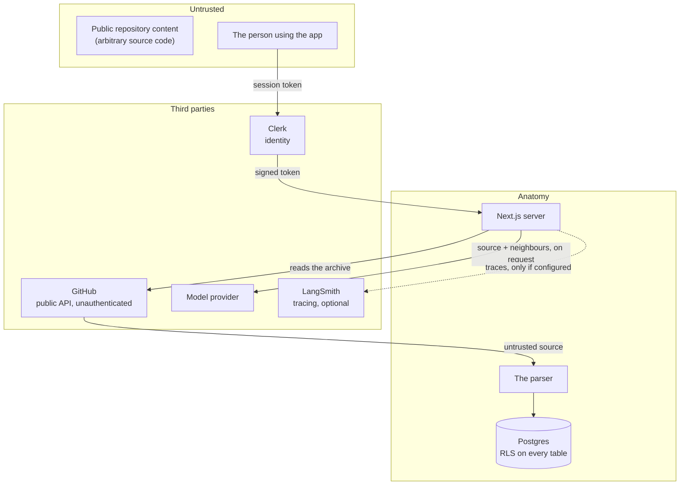

# Security and privacy

What the system trusts, what it stores, where data goes, and what is not yet
safe. Everything here was checked against the implementation or the live
database; where something is unverified, it says so.

---

## 1. Trust boundaries



**The untrusted input is repository content.** It is arbitrary source code
written by anyone, and it is the thing most likely to try to do something
unexpected. Three places meet it: the parser, the model prompt, and the
renderer.

**The user is trusted with their own organization's data and nothing else.**
That is enforced by the database, not by the application.

---

## 2. Authentication

Clerk issues the session token. The application **never asks Clerk a question
at runtime** — it reads claims off the token:

| Claim | Set by | Used for |
|---|---|---|
| `sub` | Clerk | The user. |
| `o.id` | Clerk | The active organization. Read by every row-level security policy. |
| `org_name` | A customized Clerk session token | The organization name in the dashboard header. |
| `role` | The Clerk↔Supabase integration | PostgREST's database role. Without it, PostgREST falls back to `anon` and the policies never apply. |

`proxy.ts` (Next.js 16's name for middleware) protects every route except
`/sign-in` and `/sign-up`, so a signed-out visitor is redirected before any
page's HTML is produced.

**The application holds no credential of its own.** The Clerk secret key is
used server-side, to create the organization on first sign-in. It is never
sent to the browser.

---

## 3. Authorization

### 3.1 It is a policy, not application code

Every policy in the schema reads the organization off the token:

```sql
using (organization_id = (
  select coalesce(auth.jwt() -> 'o' ->> 'id', auth.jwt() ->> 'org_id')
));
```

There is **no `where organization_id = ...` anywhere in the application code**.
If a query needed one, the policy would be wrong.

The distinction matters: a policy is evaluated by the database, on every row,
for every query, including ones written later by somebody who does not know
the rule. An application-level filter is evaluated by the code, and only where
somebody remembered.

### 3.2 Row-level security is on for every table

An event trigger enables RLS on every table created in `public`:

```sql
create event trigger ensure_rls on ddl_command_end
  execute function public.rls_auto_enable();
```

The two failure modes are not symmetrical. A table where someone forgot to
enable RLS returns every organization's rows **silently**. A table where
someone forgot to add a policy returns no rows, which is visible. The second
failure mode is possible; the first is made impossible.

The trigger function's EXECUTE privilege is revoked from `public`, `anon` and
`authenticated` — it is only ever run by Postgres itself.

### 3.3 The grants are narrower than the policies

Checked directly against the live database:

```
ai_cache      | authenticated | SELECT
analyses      | authenticated | SELECT
edges         | authenticated | SELECT
file_roles    | authenticated | SELECT
files         | authenticated | SELECT
insights      | authenticated | SELECT
organizations | authenticated | SELECT
projects      | authenticated | SELECT
routes        | authenticated | SELECT
```

**Every table grants `SELECT` to `authenticated` and nothing to `anon`.**
There is no `INSERT`, `UPDATE` or `DELETE` grant to a member, on any table.

So a member cannot write, and an unauthenticated request is refused the table
outright — `permission denied for table analyses`, not an empty result.

The three write RPCs are similarly closed:

```
insert_edges          = postgres=X/postgres | service_role=X/postgres
insert_file_roles     = postgres=X/postgres | service_role=X/postgres
insert_routes         = postgres=X/postgres | service_role=X/postgres
publish_analysis_progress = postgres=X/postgres | service_role=X/postgres
rls_auto_enable       = postgres=X/postgres | service_role=X/postgres
```

`postgres` is the owner; `service_role` is the pipeline's writer. There is no
grant to `anon`, to `authenticated`, or to `public`.

### 3.4 Two clients, deliberately

| Client | Key | Bypasses policies | Used by |
|---|---|---|---|
| `createServerSupabase()` | publishable key + the session token | No | Every read a person makes. |
| `createAdminSupabase()` | secret key | Yes | The pipeline's writer, and the answer cache. |

**The writer bypasses the policies, so every write it makes is responsible for
its own `organization_id`.** The policy covers reads; the writer covers writes.

Where the writer's `organization_id` comes from is worth stating precisely:

- **The pipeline** reads it from the analysis row, which it claimed by id.
- **The answer cache** writes the organization id the *policy just let the
  member read*, taken from the same analysis row. It is not taken from the
  request, and the request carries no organization parameter to take it from.

### 3.5 The realtime channel is private and restricted

Progress is published on the topic `analysis:{id}`, and who may subscribe is a
policy on `realtime.messages`:

```sql
using (
  extension = 'broadcast'
  and exists (
    select 1 from analyses a
    where ('analysis:' || a.id::text) = (select realtime.topic())
  )
);
```

The subquery runs under the `analyses` table's own policy, so another
organization's analysis matches no row and the join is refused. There is **no
insert policy**: browsers listen on these channels and never send. Only the
database trigger publishes.

### 3.6 Verified behaviour

The isolation has been exercised directly against Postgres, by switching the
database role and setting the claims exactly as PostgREST does:

| Scenario | Result |
|---|---|
| Owner reading everything | 2 rows |
| `authenticated` with org A's claims | Only org A's row |
| `authenticated` with org B's claims | Only org B's row |
| `authenticated` with no organization claim | 0 rows |
| `anon` | `permission denied for table analyses` |
| `authenticated` attempting an insert | `permission denied for table organizations` |

---

## 4. Repository access

**Only public repositories are analysed, and no GitHub token is used or
stored.** The pipeline talks to the GitHub API and `codeload.github.com`
unauthenticated.

This is a deliberate trade. A token would raise the rate limit and allow
private repositories, and it would have to be stored — a secret in the
database, which is a much larger liability than a rate limit.

The consequences:

- The **anonymous rate limit** applies. The pipeline detects it and says when
  it resets, rather than failing obscurely.
- **Private repositories are out of scope.** A private repository fails in the
  `fetch` stage with a message saying it does not exist or is not public.
- The **archive is downloaded to a temporary directory** created with
  `mkdtemp` and removed in a `finally` block, so a failed run leaves nothing
  behind. The limit is 100 MB.

### 4.1 Untrusted content reaches three places

**The parser.** Repository content is parsed by ts-morph, never executed. The
parser reads files, resolves specifiers and builds a graph. It does not run
anything it finds, and it does not follow symlinks.

**The model prompt.** When a person asks for an explanation, the file's source
is included in the prompt. That is the point — but it means untrusted text is
instructing a model. The prompt is explicit that the import lists are
complete and that no other file may be named, and the renderer only links a
path that is a real file, so an invented path renders as plain text rather
than a broken link. **Nothing verifies that an answer does not name a file
that does not exist.** That check is planned and not built — see
[TODO.md](../TODO.md#3-high-priority-features).

**The renderer.** The model's output is rendered as text. The permitted
formatting is three forms, and anything else is reduced rather than printed as
markup. There is no `dangerouslySetInnerHTML` anywhere, and no HTML from a
model is ever interpreted.

---

## 5. Secrets and environment variables

| Variable | Secret | Where it is used |
|---|---|---|
| `CLERK_SECRET_KEY` | Yes | Server-side only. Never sent to the browser. |
| `SUPABASE_SECRET_KEY` | Yes | Server-side only, in `createAdminSupabase()`. |
| `OPENAI_API_KEY` / `AI_API_KEY` | Yes | Server-side only, in `lib/ai/client.ts`. |
| `LANGSMITH_API_KEY` | Yes | Server-side only, for tracing. |
| `NEXT_PUBLIC_*` | No | Public by name, and safe to be: the Clerk publishable key, the Supabase publishable key and the Supabase URL. The publishable key identifies the Clerk instance, and nothing more. |

**`.env.local` is gitignored** (`.gitignore:34`) and is not tracked. The
repository contains no credential-shaped strings; the only match in a tracked
file is a base64 integrity hash in `pnpm-lock.yaml`.

**The session token is not stored by the application.** Clerk sets it as an
HTTP-only cookie. The application reads it and forwards it to Supabase as a
bearer token.

**The Supabase secret key does not reach the browser.** It has no
`NEXT_PUBLIC_` prefix, so Next.js will not inline it into the client bundle.

---

## 6. What is stored

| Table | Contents | Sensitivity |
|---|---|---|
| `organizations` | The Clerk organization id. | Low. |
| `projects` | Owner and name of an analysed repository. | Low — public repositories. |
| `analyses` | Status, commit sha, coverage report, detected projects. | Low. |
| `files` | Path, module, size, line count, **sha256 of the content**, export names, fan-in, fan-out, role, skip reason. | Low-medium: export names and file paths describe a public codebase. |
| `edges` | Resolved import relationships. | Low. |
| `routes` | Recovered HTTP routes. | Low. |
| `file_roles` | Convention and model-assigned roles. | Low. |
| `insights` | Structural findings. | Low. |
| `ai_cache` | **The model's answer text**, the task, the model name and the cache key. | **Medium.** An answer can quote source code. |

### 6.1 The answer cache contains model output

An answer is prose written by a model about a file's source. It may quote
code. It is stored in `ai_cache`, scoped to the organization, and readable
only by that organization under the same policy as everything else.

There is **no eviction and no TTL**. The table grows with every distinct
question.

### 6.2 The browser keeps answers too

`components/explanation-store.ts` keeps fetched answers in the browser's
`session storage`, keyed by analysis and target.

- `sessionStorage` is per-tab and is cleared when the tab closes.
- It is **not** cleared when the user signs out. On a shared machine, the next
  person to use the same tab could read the previous user's answers by
  opening the same analysis. This is a **known limitation** — see section 9.
- Only *finished* answers are stored. A request in flight when the page went
  away died with it.

---

## 7. Data that leaves the system

| Destination | What goes | When |
|---|---|---|
| **Clerk** | Sign-in, organization membership. | Sign-in, and the first sign-in. |
| **GitHub** | The repository URL, and a commit request. | Submitting a repository. Public data only. |
| **The model provider** | **The file's source, and the paths and export names of its neighbours.** | **Only when a person clicks Explain.** |
| **LangSmith** | The traced run: the prompt, the model's answer, token counts. | Only if `LANGSMITH_API_KEY` is set and `LANGSMITH_TRACING=true`. |
| **Supabase** | Everything in the table above. | Continuously. |

**The model provider is the significant one.** Asking for an explanation sends
the source of the file — and the identity of its neighbours — to a third
party. It is opt-in per click, it is not automatic, and the project's scope
keeps the analysed repositories public precisely so this is not a disclosure
of private code.

**LangSmith traces contain the prompt and the answer**, which means the source
code, insofar as the model quoted it, is in the trace. Tracing is off unless a
key is configured, and the pane states which state it is in rather than
implying it is on.

---

## 8. Auditability

- **Every analysis records the commit sha it was parsed at.** A file's stored
  hash is compared against GitHub's bytes at that commit, so an explanation
  always describes the code that is on the map.
- **The coverage report is complete, not sampled.** Every skipped file has a
  reason; every unresolved import has a reason.
- **The stage a run stopped at is recorded**, and the reason is in the `error`
  column.
- **Answers record the model that wrote them**, so an answer can always be
  traced to a model and a prompt version.

---

## 9. Known security limitations

These are real, and none of them is fixed.

### 9.1 The session store is not cleared on sign-out

`sessionStorage` holds fetched explanations. Signing out does not clear it. On
a shared machine, the next person to use the same browser tab and open the
same analysis could see the previous user's answers.

**Fix:** clear the store on sign-out. Small, and it should be done.

### 9.2 There is no prompt-injection defence

Repository source is untrusted text in a model prompt. A file containing
instructions addressed to the model could, in principle, influence the
answer. The prompt's honesty instruction and the renderer's refusal to link a
path that is not a real file reduce the impact, but nothing *prevents* it.

**Fix:** treat the source as data, delimit it unambiguously, and verify every
path the answer names against the stored files.

### 9.3 Nothing verifies that an answer does not name a file that does not exist

This is the check the product's own success criteria name, and it is not
built. The prompt forbids it; the renderer degrades gracefully; nothing
verifies it.

### 9.4 The pipeline's data writes are not fenced by the claim

`analyses` row updates are scoped by the run's own claim timestamp, so a run
that has been taken over stops. But the `files`, `edges`, `routes` and
`file_roles` writes in `lib/pipeline/store.ts` are **not** scoped, so two
overlapping runs on the same analysis can delete and rewrite each other's
rows.

**Impact:** a re-run racing an abandoned run can leave an analysis with
incomplete data. The analysis is not reported complete until the final update
lands, so it will read as failed rather than as wrong.

### 9.5 The archive size limit is on the download, not on disk

`MAX_ARCHIVE_BYTES` is 100 MB of *compressed* archive. The extracted tree is
not bounded, and a repository with a highly compressible payload could
occupy considerably more disk.

### 9.6 The answer cache grows without bound

No eviction, no TTL. Over time this is a storage and a retention question.

### 9.7 The archive timeout and the stale window are the same length

`ARCHIVE_TIMEOUT_MS` and `STALE_AFTER_MS` are both five minutes. A download
at the limit of its timeout can be overtaken by a re-claim while it is still
running. The claim fencing means the overtaken run stops rather than
corrupting the row — but the data writes in 9.4 are not fenced, so the two
interact.

### 9.8 The anonymous GitHub API is shared

Every user of a deployment shares the GitHub anonymous rate limit. A busy
instance can exhaust it for everyone.

---

## 10. Verification checklist

Run through this before a deployment is exposed to anyone. Each item names how
to check it.

### Schema and grants

- [ ] `select tablename, rowsecurity from pg_tables where schemaname='public';`
      — every table is `t`.
- [ ] `select table_name, grantee, privilege_type from information_schema.role_table_grants where table_schema='public' and grantee in ('anon','authenticated');`
      — `SELECT` only, `authenticated` only, no `anon` row.
- [ ] `select proname, proacl from pg_proc join pg_namespace on pg_namespace.oid=pg_proc.pronamespace where nspname='public';`
      — the write RPCs list only `postgres` and `service_role`.

### Isolation

- [ ] Sign in as two organizations. Submit the same repository in both.
- [ ] Each organization's dashboard shows only its own analysis.
- [ ] `set local role authenticated` with the other organization's claims —
      zero rows.

### Secrets

- [ ] `git ls-files | xargs grep -lE 'sk_|sb_secret_|ghp_'` — nothing.
- [ ] `git check-ignore .env.local` — ignored.
- [ ] The Supabase secret key is absent from the client bundle
      (`grep -r SUPABASE_SECRET_KEY .next/static` — nothing).

### Data flow

- [ ] Ask for an explanation and watch the provider's request log. Confirm the
      source leaves the system **only then**.
- [ ] Leave `LANGSMITH_API_KEY` unset and confirm the pane says tracing is
      off, with a reason.
- [ ] Confirm the answer cache is scoped: an organization cannot read another
      organization's `ai_cache` rows.

### Known limitations, consciously accepted

- [ ] Sign out, then open the same analysis in the same tab. Note what is
      still visible — this is 9.1.
- [ ] Decide whether the deployment will be used on shared machines, and if so
      fix 9.1 first.
